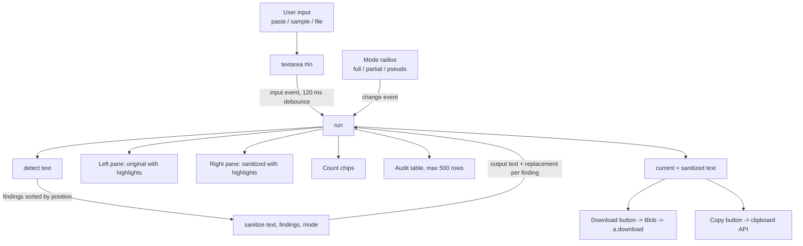
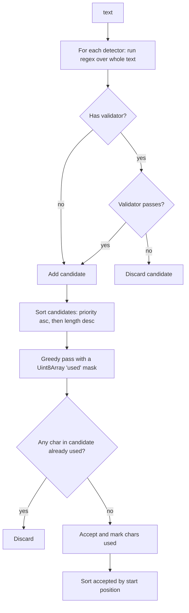

# Blackout: Architecture

A browser-only PII sanitizer. One static HTML file, no backend, no build step, no external resources. This document describes what the code in `pii-sanitizer.html` actually does.

**Status of this document:** written from the source as delivered. The pure logic (Section 4) was exercised by an automated Node check during development. The browser UI (Section 5) has **not** been manually tested; items marked *not verified* below are assumptions from reading the code.

---

## 1. Design principles

1. **Client-side only.** Nothing is uploaded or sent anywhere. A Content-Security-Policy meta tag (`default-src 'none'; style-src 'unsafe-inline'; script-src 'unsafe-inline'; connect-src 'none'; img-src data:`) blocks network connections and external resources.
2. **Deterministic.** Regular expressions plus checksum validators. No ML model, no randomness, so every redaction is explainable.
3. **Pure core, thin UI.** Detection and redaction are pure functions with no DOM access. The UI only calls them and renders results. This is what makes the core testable in Node.
4. **No persistence.** No cookies, localStorage or server storage. Closing the tab discards everything.
5. **Escape everything.** User text is never inserted into the page as raw HTML.

## 2. File layout

```
pii-sanitizer.html
├── <meta> CSP + viewport
├── <style>        theme tokens (light/dark), layout, highlight colors per entity type
├── <body>         header, input card, options card, diff card, audit card
└── <script>
    ├── // CORE START ... // CORE END    pure logic (no DOM)
    └── UI code                          rendering, events, file I/O, export
```

## 3. High-level data flow



## 4. Core logic (pure, no DOM)

Located between `// CORE START` and `// CORE END`.

### 4.1 Function reference

| Function | Purpose | Input | Output |
|---|---|---|---|
| `verhoeff(s)` | Aadhaar checksum | string | boolean. Strips non-digits, requires exactly 12 digits, runs the Verhoeff dihedral-group check |
| `luhn(s)` | Card checksum | string | boolean. Strips non-digits, requires 13 to 19 digits, rejects strings of one repeated digit, runs Luhn |
| `detect(text)` | Find all PII | string | array of `{type, start, end, value, pri}`, non-overlapping, sorted by `start` |
| `maskKeep(s, n, re)` | Mask all characters matching `re` except the last `n` of them | string, number, RegExp | string. Separators (spaces, hyphens, `+`) are preserved |
| `partial(f)` | Partial-mask one finding | finding | string, rule depends on type (see 4.4) |
| `norm(f)` | Normalized key used for pseudonym matching | finding | string |
| `sanitize(text, findings, mode)` | Build redacted text | string, findings, `'full'` / `'partial'` / `'pseudo'` | `{text, reps}` where `reps[i]` is the replacement for `findings[i]` |

Constants: `VD`, `VP` (Verhoeff tables), `O` (IPv4 octet pattern string), `DETECTORS` (array, see below).

### 4.2 The `DETECTORS` array

Each entry is `{type, re, ok?}`: a global regex and an optional validator that receives the matched string. **A detector's index in the array is its priority** (lower index wins).

| Index | Type | Pattern summary | Validator |
|---|---|---|---|
| 0 | EMAIL | `local@domain.tld` (TLD 2+ letters) | none |
| 1 | CARD | 13 to 19 digits, single space or hyphen between digits allowed | `luhn` |
| 2 | AADHAAR | first digit 2 to 9, 12 digits, optional 4-4-4 grouping | `verhoeff` |
| 3 | PAN | `[A-Z]{5}\d{4}[A-Z]`, word boundaries | 4th letter must be in `PCHFATBLJG` |
| 4 | IP | IPv4 dotted quad, each octet 0 to 255 | none (range is in the regex) |
| 5 | IP | IPv6, full eight-group form only | none |
| 6 | PHONE | Indian mobile: optional `+91`/`0091`/`0`, then `[6-9]` + 4 digits, optional separator, 5 digits | none |
| 7 | PHONE | international: `+` then a country code other than 91, then digit groups | none |

Number-based detectors (CARD, AADHAAR, PHONE) use **variable-length negative lookbehind/lookahead** (for example `(?<!\d[ -]?)` and `(?![ -]?\d)`) so they cannot match a fragment of a longer digit run.

### 4.3 Detection and overlap resolution



**Worked example (why a Luhn-failing 16-digit number is left alone):** for `1234 5678 9012 3456`, the CARD regex matches the whole string, but `luhn` returns false, so the candidate is discarded. The AADHAAR regex would otherwise match the tail `5678 9012 3456`, but its lookbehind `(?<!\d[ -]?)` sees a digit plus a space before it and refuses. The phone regex finds no valid 10-digit group. Result: nothing is flagged.

Complexity: the `used` mask check is proportional to each candidate's length, so resolution is roughly linear in total matched characters. Not benchmarked on inputs near the 5 MB cap.

### 4.4 Redaction modes

| Mode | Behavior |
|---|---|
| `full` | Every finding becomes `[REDACTED]` |
| `partial` | CARD, AADHAAR, PHONE: keep last 4 digits, other digits become `X`, separators kept (`XXXX XXXX XXXX 1111`). PAN: keep last 4 characters. EMAIL: first character + `***` + `@domain`. IPv4: first two octets + `.X.X`. IPv6: first group + seven `XXXX` groups |
| `pseudo` | Key = `type + '|' + norm(f)`. First time a key is seen, it gets `TYPE_NN` (counter per type, zero-padded to 2 digits); later occurrences reuse it |

`norm(f)` rules: EMAIL lowercased; PAN and IP uppercased; every other type reduced to digits only, then a leading `91`, `00` or `0` is removed when exactly 10 digits remain (so `+91 98765 43210` and `9876543210` match). Counters and the mapping live inside one `sanitize` call, so they reset every time and are never persisted.

## 5. UI layer

### 5.1 State

Module-level variables: `mode` (current redaction mode), `baseName` and `ext` (for the download filename), `current` (latest sanitized text), `timer` (debounce handle).

### 5.2 DOM elements (by id)

`in` (textarea), `sample`, `file`, `clear`, `msg` (status line), `chips` (counts), `modeHelp`, `left` and `right` (diff panes), `dl`, `copy`, `audit` (table), `auditNote`.

### 5.3 UI functions

| Function | Role |
|---|---|
| `esc(s)` | HTML-escapes `& < > " '` |
| `lineStarts(t)` / `lineOf(a, i)` | Precompute line-start offsets; binary-search the line number of an offset for the audit table |
| `view(text, fs, vals, side)` | Builds the highlighted HTML for a pane. Plain segments and values are passed through `esc`; each finding is wrapped in `<mark class="t-TYPE">`. `side=false` shows original values, `side=true` shows `vals[i]` |
| `run()` | Orchestrator: detect, sanitize, render both panes, rebuild chips and audit table (via `createElement` and `textContent`), update button states and the mode help text |
| `schedule()` | Debounces `run()` by 120 ms |
| `msg(text, isError)` | Sets the status line text and style |
| `sync(a, b)` | Mirrors scroll position between panes by scroll ratio, guarded against feedback loops |

### 5.4 Event handlers

- `#in` `input` -> `schedule`
- mode radios `change` -> set `mode`, `run`
- `#sample` -> loads the built-in noisy text, `run`
- `#clear` -> empties input, `run`
- `#file` `change` -> validates extension (`.txt`/`.csv`) and size (5 MB), reads with `File.text()`, sets `baseName` and `ext`, `run`
- `#dl` -> `Blob` of `current` (`text/plain` or `text/csv`, UTF-8), temporary `<a download>` named `<baseName>.sanitized<ext>`, object URL revoked after 2 s
- `#copy` -> `navigator.clipboard.writeText`, with an error message if blocked

### 5.5 CSV handling

CSV files are treated as plain text. There is no CSV parsing, so detection runs across the raw content including delimiters. No replacement string contains a comma, so redaction cannot add or split columns.

## 6. Security model

| Control | Where | Notes |
|---|---|---|
| No network | CSP `connect-src 'none'`, `default-src 'none'`, no external assets | Verify in the browser network tab during demo |
| No raw HTML injection | `esc()` in `view`; `textContent` for chips, audit rows and status | Test by pasting ``: it must display as text. *Not verified in a browser* |
| Input limits | `.txt`/`.csv` extension check, 5 MB cap | Extension check is by filename only |
| No persistence | No cookies or storage APIs used | |
| Inline script/style | Required by single-file design, so CSP allows `'unsafe-inline'` for them | Acceptable here because the page loads no third-party or user-supplied script |

## 7. Compatibility

Requires regex **lookbehind**, including variable-length lookbehind: current Chrome, Edge, Firefox, and Safari 16.4 or later. Older browsers will fail when the script is parsed. Also uses `File.text()`, `Blob`, and the Clipboard API (the last degrades gracefully).

## 8. Known limitations and quirks

- No detection of names, addresses or other contextual PII.
- Compressed IPv6 (`::1` style) is not matched. PAN must be uppercase.
- A real card number glued directly to extra digits can be missed, because the combined sequence fails Luhn.
- Phone detection is format-based: any isolated 10-digit number starting 6 to 9 is flagged.
- `norm()` applies the leading-prefix strip to every numeric type, not only phones. This has no practical collision effect (keys also include the type), but it could be restricted to PHONE for clarity.
- The audit table displays original values on screen by design. Do not screen-share or screenshot it with real data.
- The panes are rebuilt with `innerHTML` on every run; very large inputs have not been performance tested.
- Pseudonym numbering resets per run and cannot be linked across files.
- Redaction reduces risk; it is not legal anonymization. Partially masked or pseudonymized output may still be personal data.

## 9. Testing approach

The core can be tested without a browser by extracting the text between the markers and evaluating it:

```js
const fs = require('fs');
const html = fs.readFileSync('pii-sanitizer.html', 'utf8');
const core = html.match(/\/\/ CORE START([\s\S]*?)\/\/ CORE END/)[1];
const { detect, sanitize, luhn, verhoeff } =
  new Function(core + '; return { detect, sanitize, luhn, verhoeff }')();
```

Suggested cases:

- Positive: valid card (`4111 1111 1111 1111`), valid Aadhaar (checksum-valid), valid PAN, IPv4, email, `+91` and bare Indian mobile.
- Decoys that must NOT be flagged: Luhn-failing 16-digit numbers, an Aadhaar-shaped number failing Verhoeff, a PAN with an invalid 4th letter, `999.12.1.5`, `0000000000000000`.
- Overlap: no two findings share a character.
- Pseudonymization: `A@x.com` and `a@X.com` share one placeholder.
- Partial mode output formats for each type.
- Empty string, very long input, input with no PII.

Manual browser checklist (required before submission): sample loader, typing, all three modes, `.txt` and `.csv` upload, rejection of other types and files over 5 MB, download name and contents, copy, synced scrolling, light and dark themes, mobile width, and zero requests in the network tab.

## 10. Extension points

| To add | Change |
|---|---|
| A new PII type | Add a `DETECTORS` entry (position sets priority), a `LABEL` entry, `--TYPE` color variable and `.t-TYPE` CSS rule, and a case in `partial()` |
| Names / NER | Run a local model on text before or after `detect`, emit findings in the same `{type, start, end, value}` shape so the overlap resolver and renderers work unchanged |
| Per-finding override | Keep a set of ignored finding keys in UI state and filter `findings` before `sanitize` |
| New export format | Add another consumer of `current` next to the download handler |

## 11. Blackout Guard Extension Architecture

The repository includes a companion Manifest V3 browser extension (`extension/`) that extends Blackout's detection and redaction engine to any live web form.

### Component Structure
1. `manifest.json`: Manifest V3 specification with minimal permissions `["activeTab", "scripting"]`. No background service worker, no host permissions.
2. `popup.html`, `popup.css`, `popup.js`: Popup UI allowing users to initiate on-demand scans, review masked previews, select redaction modes (Full, Partial, Pseudo, Delete), execute page-wide wipes, undo changes, and toggle Guard Mode.
3. `content.js`: Injected into the active tab on demand. Scans DOM editable inputs, excludes password/hidden inputs, renders Shadow DOM indicator badges, applies updates using React-compatible prototype descriptors, and intercepts paste events in Guard Mode.
4. `pii-core.js`: Byte-for-byte exact copy of `// CORE START` to `// CORE END` from `pii-sanitizer.html`.
5. `test-page.html`: Comprehensive synthetic testbed featuring plain inputs, textareas, contenteditable elements, hidden/password fields, same-origin iframe, and React simulated state bindings.

### Data Flow & Isolation
- **Inter-Process Messaging:** Popup communicates with `content.js` via `chrome.tabs.sendMessage` using actions: `SCAN`, `WIPE`, `UNDO`, `SET_GUARD_MODE`, `GET_GUARD_MODE`.
- **Shadow DOM Badges:** Visual indicators and Guard Mode paste dialogs are rendered in open Shadow DOM hosts, fully isolating styling from the host web page.
- **Controlled Framework Compatibility:** Value changes bypass framework setters via `Object.getOwnPropertyDescriptor(HTMLInputElement.prototype, 'value').set` followed by bubbling `input` and `change` events.
