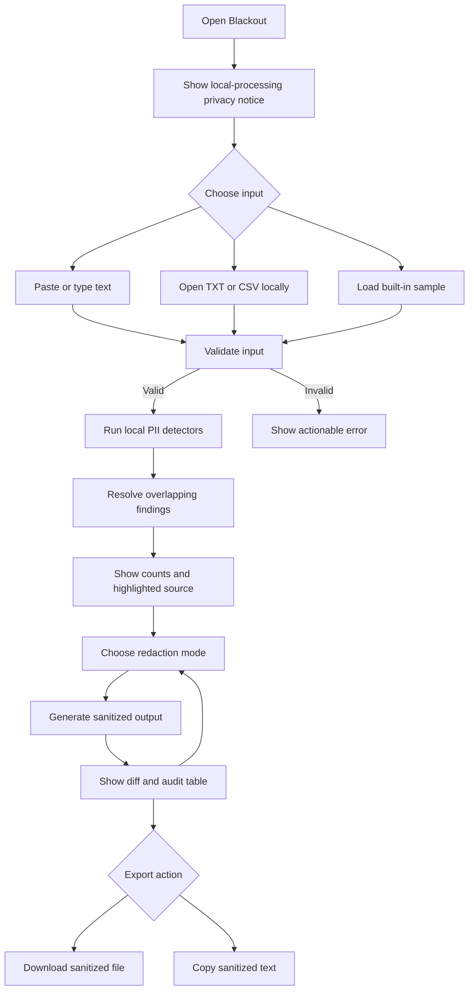
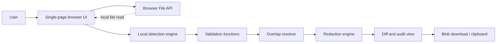
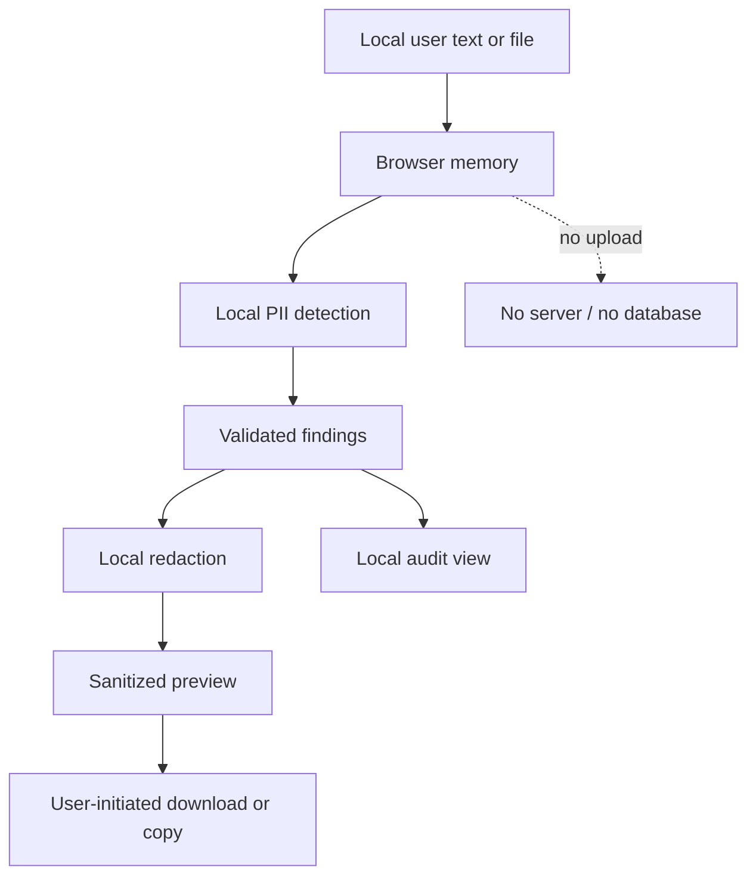

# Blackout — Product Requirements Document (PRD)

**Product:** Blackout  
**Product type:** Browser-only PII detection and text sanitization web application  
**Event:** PromptWars x NIAT Pune — Cybersecurity & Data Privacy Challenge  
**Document version:** 1.1  
**Source baseline:** Blackout Product Requirements Document, version 1.0, dated 27 November 2026  
**PRD status:** Implementation-ready MVP specification  
**Implementation status:** Core detection and redaction logic has been tested in Node. Browser UI and end-to-end behavior still require manual verification.

---

## Document conventions

This PRD distinguishes current evidence from future requirements:

- **VERIFIED** — directly stated as completed and tested in the supplied project document.
- **PARTIAL** — implementation exists, but end-to-end or browser verification is incomplete.
- **PLANNED** — included in the MVP specification but not yet verified as complete.
- **RECOMMENDED** — a proposed improvement, not a current capability.
- **UNVERIFIED** — the supplied project information does not establish whether it exists or works.

Priorities:

- **P0 — Critical:** required for the hackathon MVP and core user journey.
- **P1 — Important:** materially improves usability, trust or completeness.
- **P2 — Useful:** valuable enhancement if time permits.
- **P3 — Future:** post-hackathon scope.

This is a browser-only product. The absence of a backend is intentional, not an implementation gap. The application must not introduce server-side processing, remote AI calls, analytics or external assets that would contradict its privacy promise.

# 1. Product Overview

## 1.1 Product definition

**Blackout** is a single-page web application that detects selected categories of personally identifiable information (PII) in text, lets users redact those findings using one of three modes, displays a side-by-side comparison and audit log, and exports the sanitized result.

All document processing occurs locally inside the user's browser tab. The product is designed so that the user's text is not sent to a server.

**Tagline:** Sanitize sensitive text in seconds. Your data stays in your browser.

## 1.2 Problem statement

Individuals and organizations routinely share text logs, resumes, support tickets, clinical notes and CSV exports that may contain personal information. Manually finding and removing that information is slow, inconsistent and error-prone. Online redaction tools can introduce a second exposure by requiring users to upload the very data they want to protect. Simple pattern matching can also flag harmless values that resemble identifiers, reducing trust in the tool.

Blackout addresses this problem by providing local, validated detection and user-controlled redaction without uploading source content.

## 1.3 Product vision

Make privacy-aware text sharing accessible to non-technical users through a fast, transparent, zero-setup browser tool.

## 1.4 One-sentence value proposition

Blackout helps people prepare text for safer sharing by identifying selected PII categories, explaining each finding and generating a sanitized copy without transmitting the source text.

## 1.5 Target users

| Persona | Context | Primary need |
|---|---|---|
| Support engineer | Shares customer tickets, logs or bug reports with vendors and teammates | Remove contact, payment and network identifiers before sharing |
| HR coordinator | Shares resumes or candidate CSV exports | Hide contact and identity details while retaining document readability |
| Clinic or small-office administrator | Shares notes with consultants or researchers | Remove supported identifiers without uploading records to another service |
| Student or researcher | Prepares text datasets for analysis | Replace identifiers consistently while retaining the ability to correlate repeated values within one document |

## 1.6 Product scope

### MVP includes

- Single-page browser application with no sign-in.
- Paste/type text input.
- Local opening of `.txt` and `.csv` files.
- Maximum file size of 5 MB.
- Built-in sample containing supported PII and false-positive decoys.
- Deterministic detection for six categories: email, credit card, Aadhaar, PAN, IP address and phone number.
- Validation logic for supported identifier formats.
- Three redaction modes: full mask, partial mask and consistent pseudonymization.
- Side-by-side original and sanitized views.
- Detection counts and line-numbered audit log.
- Download sanitized output and copy to clipboard.
- Privacy messaging and a demonstrable no-network design.

### Explicitly out of scope for MVP

- Names, physical addresses, organizations and other contextual PII requiring named-entity recognition.
- PDF, DOCX, image or scanned-document processing.
- User accounts, cloud storage, collaboration or saved history.
- Server-side APIs or batch processing.
- Legal guarantees of anonymization or regulatory compliance.
- Cross-document pseudonym mapping.
- AI/LLM-based detection.

## 1.7 Product principles

1. **Local-first privacy:** source text remains in the browser tab.
2. **Transparency:** every detection and replacement is reviewable.
3. **Validation over naive matching:** use checksums and format constraints where applicable.
4. **User control:** users choose the redaction mode.
5. **Honest limitations:** explain what is and is not detected.
6. **Minimalism:** no account, setup or unnecessary workflow steps.

# 2. Problem Alignment & Value

## 2.1 Current workflow and pain points

| Current approach | Pain point |
|---|---|
| Manual search and redaction | Slow, inconsistent and easy to miss |
| Online redaction service | Requires sharing sensitive source data with another party |
| Basic regular expressions | Can flag harmless look-alike values and create false positives |
| General-purpose document editor | Does not provide a purpose-built detection summary, validation or auditable redaction workflow |

## 2.2 Proposed solution

Blackout performs local pattern detection with validation, presents findings for review, applies the selected redaction mode and provides a sanitized export.

## 2.3 Problem-to-capability traceability

| Problem / pain point | Product capability | User outcome | Verification |
|---|---|---|---|
| Manual redaction is slow | Live local detection | User sees supported identifiers without manually searching | Paste a test sample and verify expected findings |
| Online tools require uploading sensitive data | Browser-only processing and restrictive CSP | Source text does not need to leave the tab | Inspect browser Network panel during use |
| Naive patterns produce false positives | Luhn, Verhoeff, PAN holder-code and IP validation | Invalid look-alikes are filtered where validation applies | Run positive and decoy test cases |
| Users cannot tell what changed | Highlighted before/after comparison | User can review each replacement | Verify both panes and finding positions |
| Users need different privacy/usefulness trade-offs | Three redaction modes | User chooses full masking, partial masking or within-document pseudonyms | Exercise all modes against the same sample |
| Users need an exportable result | Download and clipboard actions | User can use the sanitized content elsewhere | Verify output contents and file name |

## 2.4 Core user journey

1. Open Blackout.
2. Read the local-processing privacy notice.
3. Paste text, open a supported local file or load the built-in sample.
4. Review automatically detected findings and category counts.
5. Choose a redaction mode.
6. Review the sanitized output and audit table.
7. Download or copy the sanitized result.
8. Close the tab to discard the in-memory session.

## 2.5 Success metrics

These are MVP acceptance targets, not claims of measured production performance.

| Metric | Target | Verification method |
|---|---|---|
| Built-in sample detection | Exact expected set of 16 findings | Automated test against the sample |
| Built-in sample decoys | Zero decoys flagged | Automated negative test cases |
| Finding overlap | No overlapping findings | Automated overlap assertion |
| Network requests during normal use | Zero | Browser Network panel |
| First sanitized output | Under 10 seconds for a new user | Timed usability demonstration |
| Mandatory MVP requirements | All P0 requirements pass | Acceptance checklist |
| Browser UI readiness | All listed manual checks pass | Manual browser test plan |

Any precision, recall or accuracy claims beyond the built-in sample must be measured using a labeled test set and reported with the test-set scope.

# 3. Personas & User Stories

## 3.1 Support engineer

**Goals**
- Share diagnostic text without exposing supported customer identifiers.
- Quickly inspect what will be changed.

**Pain points**
- Logs and support tickets may contain contact details, IP addresses or payment identifiers.
- Manual cleanup is inconsistent.

**User stories**
- **US-001 (P0):** As a support engineer, I want to paste a ticket and see supported PII highlighted so that I can review it before sharing.
- **US-002 (P0):** As a support engineer, I want to download sanitized text so that I can use it in another workflow.

## 3.2 HR coordinator

**Goals**
- Prepare resumes and candidate CSV data for safer internal review.
- Preserve enough document structure to remain useful.

**User stories**
- **US-003 (P0):** As an HR coordinator, I want to open a local CSV or TXT file without uploading it so that the source remains on my device.
- **US-004 (P1):** As an HR coordinator, I want partial masking so that reviewers can verify limited context without seeing the full identifier.

## 3.3 Clinic or small-office administrator

**Goals**
- Reduce unnecessary exposure when sharing text notes.
- Avoid installing or configuring software.

**User stories**
- **US-005 (P0):** As an administrator, I want a tool that works immediately in a browser without an account.
- **US-006 (P0):** As an administrator, I want clear warnings about unsupported PII so that I do not mistake a partial scan for complete anonymization.

## 3.4 Student or researcher

**Goals**
- Prepare a text dataset while retaining within-document relationships between repeated identifiers.

**User stories**
- **US-007 (P0):** As a researcher, I want repeated normalized values to map to the same placeholder within a document.
- **US-008 (P1):** As a researcher, I want counts of total and unique findings by category.

## 3.5 First-time visitor or judge

**Goals**
- Understand the product and see its core workflow quickly.

**User stories**
- **US-009 (P0):** As a first-time visitor, I want to load a realistic sample with one click so that I can see the product working immediately.
- **US-010 (P0):** As a privacy-conscious visitor, I want a clear way to verify that the application makes no network requests.

# 4. Information Architecture & User Flows

## 4.1 Application structure

Blackout is a single-page application. It does not require navigation, sign-in or an account.

Main interface regions:

1. **Privacy banner:** explains that processing is local.
2. **Input area:** paste/type text, open file, load sample and clear.
3. **Detection summary:** total findings, unique values and per-category counts.
4. **Redaction controls:** full mask, partial mask and consistent pseudonymization.
5. **Comparison workspace:** original and sanitized panes.
6. **Audit table:** category, line number, original value and replacement.
7. **Export controls:** download and copy.
8. **Limitations notice:** explains supported categories and non-guarantees.

## 4.2 Main workflow



## 4.3 Permissions

There are no user accounts or roles in the MVP. The user controls local input and output within their own browser session. No remote identity or authorization layer is required.

# 5. Functional Requirements

## 5.1 Input and session management

### FR-001 — Paste or type text
- **Status:** VERIFIED as a specified requirement; browser behavior UNVERIFIED.
- **Priority:** P0.
- **Actor:** User.
- **Expected behavior:** Provide a labeled text input area. Detection and output update as the user edits text.
- **Acceptance criteria:**
  - Given the page is open, when the user enters text, the application processes it locally.
  - Empty input produces a clear empty state.
  - Pasted markup-like content is displayed as text, not executed as HTML.

### FR-002 — Open local TXT and CSV files
- **Status:** PLANNED / browser verification pending.
- **Priority:** P0.
- **Actor:** User.
- **Expected behavior:** Use the browser File API to read `.txt` and `.csv` files locally.
- **Acceptance criteria:**
  - Supported files are read without an upload request.
  - Original extension is retained for the sanitized export.
  - Unsupported extensions are rejected with a plain-language message.

### FR-003 — File size limit
- **Status:** PLANNED / browser verification pending.
- **Priority:** P0.
- **Expected behavior:** Reject files larger than 5 MB.
- **Acceptance criteria:** A file over the limit is not processed and the error explains the 5 MB maximum.

### FR-004 — Built-in sample
- **Status:** VERIFIED in the supplied project checklist; browser behavior UNVERIFIED.
- **Priority:** P0.
- **Expected behavior:** A single action loads a realistic sample containing all supported detector categories and false-positive decoys.
- **Acceptance criteria:** Sample contains the known expected 16 findings and decoys used by the automated test suite.

### FR-005 — Clear input and output
- **Status:** PLANNED.
- **Priority:** P1.
- **Expected behavior:** Clear resets source text, findings, sanitized output, counts, audit entries and source filename.
- **Acceptance criteria:** No stale result remains after clearing.

## 5.2 PII detection

Detection is deterministic and uses regular expressions plus validation functions. The MVP does not use a machine-learning model.

### FR-010 — Email detection
- **Status:** VERIFIED in core logic test scope.
- **Priority:** P0.
- **Rule:** Standard local part, `@`, domain and top-level domain with at least two letters.
- **Validation:** Pattern-based; no external verification.
- **Acceptance criteria:** Valid sample email is detected and the finding span is correct.

### FR-011 — Credit-card-like number detection
- **Status:** VERIFIED in core logic test scope.
- **Priority:** P0.
- **Rule:** 13–19 digits, optionally separated by single spaces or hyphens.
- **Validation:** Luhn checksum must pass; all-identical repeated-digit strings are rejected.
- **Acceptance criteria:** Known valid Luhn test values are detected; invalid checksum and repeated-digit decoys are ignored.

### FR-012 — Aadhaar detection
- **Status:** VERIFIED in core logic test scope.
- **Priority:** P0.
- **Rule:** 12 digits beginning 2–9, optionally grouped 4-4-4 using spaces or hyphens.
- **Validation:** Verhoeff checksum must pass.
- **Acceptance criteria:** Valid test value passes; invalid-checksum decoy is ignored.
- **Privacy note:** The detector validates a format/checksum pattern; it does not establish that an identifier was issued or belongs to a person.

### FR-013 — PAN detection
- **Status:** VERIFIED in core logic test scope.
- **Priority:** P0.
- **Rule:** Five uppercase letters, four digits, one uppercase letter.
- **Validation:** Fourth letter must be one of the holder-type codes: P, C, H, F, A, T, B, L, J or G.
- **Acceptance criteria:** Valid-format test values are detected; invalid holder-code decoys are ignored.

### FR-014 — IP address detection
- **Status:** VERIFIED in core logic test scope.
- **Priority:** P0.
- **Rule:** IPv4 dotted quad or IPv6 in full eight-group form.
- **Validation:** Each IPv4 octet must be in the range 0–255.
- **Known limitation:** Compressed IPv6 notation such as `::1` is not detected.
- **Acceptance criteria:** Valid test addresses are detected; out-of-range IPv4 decoys are ignored.

### FR-015 — Phone number detection
- **Status:** VERIFIED in core logic test scope.
- **Priority:** P0.
- **Rule:** Indian mobile numbers of 10 digits starting 6–9, optionally prefixed with +91, 0091 or a leading 0; optional single separator after the fifth digit. Also heuristic international numbers beginning with `+`.
- **Validation:** Format-based; no carrier or ownership verification.
- **Acceptance criteria:** Sample phone formats are detected and returned with correct spans.
- **Known limitation:** A 10-digit number starting 6–9 that is not a phone number may be flagged.

### FR-016 — Overlap resolution
- **Status:** VERIFIED in core logic test scope.
- **Priority:** P0.
- **Expected behavior:** Keep exactly one finding when detectors overlap.
- **Priority order:** Email, Card, Aadhaar, PAN, IP, Phone. Ties go to the longer match.
- **Acceptance criteria:** No character belongs to more than one finding.

### FR-017 — Digit boundary protection
- **Status:** VERIFIED in core logic test scope.
- **Priority:** P0.
- **Expected behavior:** Number-based detectors must not match a fragment of a longer digit sequence.
- **Acceptance criteria:** A validated identifier is not extracted from the tail of a failed longer numeric candidate.

## 5.3 Redaction modes

### FR-020 — Full mask
- **Status:** VERIFIED in core logic test scope.
- **Priority:** P0.
- **Behavior:** Replace every finding with `[REDACTED]`.
- **Acceptance criteria:** Every accepted finding is replaced and non-finding text is preserved.

### FR-021 — Partial mask
- **Status:** VERIFIED in core logic test scope.
- **Priority:** P0.
- **Behavior:** Retain limited context for verification:
  - Card: `XXXX XXXX XXXX 1111`
  - Aadhaar: `XXXX XXXX 0124`
  - Phone: retain last four digits
  - PAN: retain last four characters
  - Email: retain first character and domain, e.g. `r***@example.com`
  - IPv4: retain first two octets, e.g. `192.168.X.X`
- **Acceptance criteria:** Output follows the category-specific masking rule and does not reveal the full detected value.

### FR-022 — Consistent pseudonymization
- **Status:** VERIFIED in core logic test scope.
- **Priority:** P0.
- **Behavior:** The same normalized value maps to the same placeholder throughout one document.
- **Examples:** `EMAIL_01`, `PHONE_02`, `CARD_01`.
- **Normalization rules:**
  - Emails compare case-insensitively.
  - Numeric identifiers compare using digits only.
  - Indian mobile numbers compare without country prefix.
  - PAN and IP values compare case-insensitively.
  - Placeholder numbering is per category and restarts for each document.
  - Mappings are not persisted.
- **Acceptance criteria:** Repeated normalized values receive the same placeholder; different values receive distinct placeholders within their category.

## 5.4 Diff, counts and audit

### FR-030 — Side-by-side comparison
- **Status:** PLANNED / browser verification pending.
- **Priority:** P0.
- **Expected behavior:** Original pane highlights detections by category; sanitized pane highlights replacements.
- **Acceptance criteria:** Both panes represent the same source document and all accepted findings have corresponding replacements.

### FR-031 — Synchronized scrolling
- **Status:** PLANNED.
- **Priority:** P1.
- **Expected behavior:** Scrolling one pane keeps the other pane aligned where practical.
- **Acceptance criteria:** Verify alignment on a multi-line sample and on narrow screens.

### FR-032 — Detection counts
- **Status:** PLANNED / browser verification pending.
- **Priority:** P0.
- **Expected behavior:** Show per-category counts, total findings and unique values.
- **Acceptance criteria:** Displayed counts match the detector output and pseudonymization normalization.

### FR-033 — Audit table
- **Status:** PLANNED / browser verification pending.
- **Priority:** P0.
- **Expected behavior:** List each finding with category, line number, original value and replacement. Show the first 500 findings and a note when additional findings exist.
- **Acceptance criteria:** Every displayed audit row maps to one finding and its replacement.
- **Security/UX note:** The audit table intentionally displays original values for review. It must remain local and must not be included in sanitized exports by default.

### FR-034 — Live updates
- **Status:** Core logic tested; browser behavior UNVERIFIED.
- **Priority:** P0.
- **Expected behavior:** Results update as the user types or changes redaction mode.
- **Performance target:** Current debounce is 120 ms; target behavior is responsive updates for typical documents of a few thousand lines.
- **Acceptance criteria:** No stale output remains after text or mode changes.

## 5.5 Export

### FR-040 — Download sanitized output
- **Status:** Built according to supplied checklist; manual verification pending.
- **Priority:** P0.
- **Expected behavior:** Download as `<name>.sanitized.txt` or `<name>.sanitized.csv`, matching the original input type. For pasted text, use a sensible default filename.
- **Acceptance criteria:** Downloaded file contains only sanitized output and uses the expected filename and extension.

### FR-041 — Copy sanitized output
- **Status:** PLANNED / manual verification pending.
- **Priority:** P1.
- **Expected behavior:** Copy sanitized text to clipboard and show a success or fallback message.
- **Acceptance criteria:** Clipboard success is confirmed where supported; blocked clipboard access produces a graceful instruction to select and copy manually.

## 5.6 Privacy transparency

### FR-050 — Local processing notice
- **Status:** PLANNED.
- **Priority:** P0.
- **Expected behavior:** Show a visible statement that text processing occurs inside the browser tab and that source text is not sent to a server.
- **Acceptance criteria:** Notice is visible without scrolling and is not phrased as a legal guarantee of complete anonymity.

### FR-051 — Limitations notice
- **Status:** PLANNED.
- **Priority:** P0.
- **Expected behavior:** Explain supported categories and important omissions, especially names and addresses.
- **Acceptance criteria:** Users are told that undetected PII may remain and that partial masking or pseudonymization may still be personal data.

# 6. Full-Stack Implementation Specification

## 6.1 Architecture decision

**Architecture:** static, client-side web application.

The supplied project specification explicitly requires no server-side processing and no network requests. Therefore, a conventional frontend/backend/database architecture is not appropriate for the MVP.

### Proposed runtime architecture



All arrows represent local browser operations. There must be no remote processing path.

## 6.2 Frontend requirements

- Single-page interface; no sign-in or navigation.
- Use accessible labeled controls.
- Keep input, findings, redaction mode, output and audit data in in-memory application state.
- Do not persist sensitive text in local storage, session storage, IndexedDB, cookies or browser databases.
- Use safe text rendering. Never insert user-controlled content as raw HTML.
- Provide clear loading, empty, success and error states.
- Stack comparison panes on narrow viewports.
- Respect system light/dark preference.
- Ensure keyboard focus is visible and status updates are announced to assistive technology.

The supplied source describes a single static HTML file with no build step. A framework migration is not required by this PRD and should not be undertaken unless the team explicitly changes the product architecture and revalidates the privacy guarantees.

## 6.3 Backend requirements

There is no backend in the MVP.

| Backend concern | MVP decision |
|---|---|
| API server | Not used |
| Authentication | Not used |
| Database | Not used |
| File upload endpoint | Not used |
| AI provider | Not used |
| Analytics | Not used |
| Server-side logs containing user content | Not used |

Any future proposal to add a backend must be treated as an architectural change requiring a new threat model, explicit user consent, data-flow documentation and revised privacy claims.

## 6.4 API matrix

No application API endpoints are required or planned for the MVP.

| Operation | Implementation | Network request |
|---|---|---|
| Read local file | Browser File API | No |
| Detect PII | Local JavaScript logic | No |
| Validate identifier | Local validation functions | No |
| Redact text | Local JavaScript logic | No |
| Download output | Browser Blob/object URL | No |
| Copy output | Clipboard API, where permitted | No |

## 6.5 Database

No database is used.

- No user records.
- No document records.
- No detection history.
- No persistent pseudonym mapping.
- No stored audit log.
- All working data is held in memory for the active tab session.

# 7. AI Integration & Security

## 7.1 AI integration decision

Blackout MVP does **not** use AI, machine learning, an LLM or an external model.

Detection is deterministic: regular expressions plus validation functions. This is deliberate because the product's main promise is local processing and the current MVP has a narrow, well-defined set of identifier formats.

Do not add an external AI service to the MVP. Doing so would contradict the no-network requirement and could expose the source text.

## 7.2 Potential future local AI enhancement

**Status: RECOMMENDED / post-hackathon.**

A small named-entity recognition model could potentially run locally in the browser to identify names and addresses. Before implementation, evaluate:

- Whether the model can run entirely offline.
- Model download and caching behavior.
- Browser memory and performance.
- Accuracy on English, Hindi and Marathi text.
- Whether model assets introduce external network requests.
- Whether the privacy notice remains accurate on first load and subsequent use.

The future feature must not silently transmit user text to an inference provider.

## 7.3 Security checklist

| Control | Status | Requirement / evidence |
|---|---|---|
| No network requests | Built by design; browser verification pending | Verify in browser Network panel |
| Restrictive CSP | Specified; deployed behavior UNVERIFIED | Meta CSP blocks outgoing connections and external resources |
| Safe text rendering | Specified; hostile-input test pending | Render user input as text, never raw HTML |
| No persistent storage | Specified; browser verification pending | No cookies, local storage or server storage |
| File type allowlist | Specified; browser verification pending | Accept only TXT and CSV |
| File size cap | Specified; browser verification pending | Reject files over 5 MB |
| External scripts/fonts/assets | Prohibited | Bundle all required resources locally |
| Analytics/telemetry | Prohibited | No analytics or tracking |
| Secret management | Not applicable to current MVP | No API keys or provider secrets required |

## 7.4 Content Security Policy

The source specification calls for a CSP meta tag that blocks outgoing connections and external resources, including:

```text
default-src 'none';
connect-src 'none';
```

The implementation must add only the minimum directives required for the app's own inline or bundled resources. Test the actual deployed page to ensure the policy does not unintentionally block core functionality and does not permit remote connections.

## 7.5 Threat considerations

- **Script injection through pasted content:** use text-only rendering and test hostile strings.
- **Accidental data transmission:** prohibit external resources and verify with the Network panel.
- **False confidence:** explain detector coverage and limitations prominently.
- **Sensitive audit display:** audit entries contain original values; keep them local and exclude them from exports.
- **Clipboard leakage:** copying is user-initiated; explain that the destination application may retain copied content.
- **Browser extensions or compromised devices:** Blackout cannot protect data from a compromised browser, malicious extensions or malware on the user's device.

# 8. UX & Working Deployment

## 8.1 Deployment model

The application is a static page that can be opened locally or hosted on a static host.

Hosting must not introduce:
- Server-side text processing.
- Analytics.
- Remote fonts, images, scripts or styles.
- Telemetry.
- Document upload endpoints.

The supplied project document does not identify a final hosting provider or verified live URL.

## 8.2 Environment variables

No environment variables are required for the static MVP.

## 8.3 Build and start

The supplied specification describes a single static HTML file with no build step. Exact filenames and commands are not established by the source and must be documented by the implementation team.

## 8.4 Required UX states

| State | Expected behavior |
|---|---|
| Initial | Explain local processing and show input choices |
| Empty input | Show guidance to paste, open or load sample |
| Processing | Keep the interface responsive and indicate work if needed |
| Results | Show findings, counts, selected mode and sanitized output |
| No findings | State that no supported patterns were detected; do not claim the document contains no PII |
| Unsupported file | Explain accepted file types |
| Oversize file | Explain the 5 MB limit |
| Clipboard blocked | Provide manual copy fallback |
| Download failure | Keep sanitized output visible and explain alternate copy action |
| Browser unsupported | Explain modern browser requirement |

## 8.5 Browser compatibility

The source uses regular-expression lookbehind assertions. Supported browsers are modern evergreen browsers: current Chrome, Edge, Firefox and Safari 16.4 or later. Older browsers are unsupported.

## 8.6 Performance

- Current debounce in the source is 120 ms.
- Target responsive updates for typical documents of a few thousand lines.
- Inputs up to 5 MB are accepted by the file-size rule, but performance near that limit has not been benchmarked.
- Do not advertise performance at the maximum file size until measured on target browsers and devices.

# 9. UI/UX Requirements

## 9.1 Design direction

The interface should feel like a focused privacy utility, not a generic analytics dashboard.

- Clear hierarchy and restrained visual styling.
- Distinct category colors, supported by text labels and icons so color is never the only signal.
- Visible local-processing message.
- Large, readable input and output areas.
- Clear mode selection.
- Compact detection summary.
- Readable audit table.
- Responsive layout that stacks the two comparison panes on narrow screens.
- Respect light/dark system preference.
- Avoid decorative motion that distracts from reviewing sensitive findings.

## 9.2 Accessibility

- All controls have visible labels.
- All functionality is keyboard accessible.
- Focus indicators are visible.
- Status messages are announced to assistive technology.
- Category meaning is not communicated by color alone.
- Text remains readable at common zoom levels.
- Tables use meaningful headers.
- Responsive layout avoids horizontal overflow where possible.

# 10. Data Requirements

## 10.1 Data handled

| Data | Purpose | Storage | Retention |
|---|---|---|---|
| User-provided text | Detection and redaction | Browser memory | Until cleared or tab closed |
| Local file bytes/text | Local parsing | Browser memory | Until cleared or tab closed |
| Detection spans and categories | Highlighting and counts | Browser memory | Current session |
| Pseudonym mapping | Consistent replacement within document | Browser memory | Current document only |
| Audit rows | Review findings and replacements | Browser memory | Current session |
| Sanitized output | Preview and export | Browser memory | Current session / user download |

## 10.2 Data minimization

- Do not store source content persistently.
- Do not retain mappings across documents.
- Do not send audit values to telemetry or logs.
- Do not include the original text or audit table in the sanitized export.
- Clear in-memory references when the user clears the document. Closing the tab ends the session, subject to normal browser memory behavior.

## 10.3 Data-flow diagram



# 11. Non-Functional Requirements

| ID | Area | Requirement | Priority |
|---|---|---|---|
| NFR-001 | Privacy | No network requests during normal application use | P0 |
| NFR-002 | Privacy | No persistent storage of source text or mappings | P0 |
| NFR-003 | Security | User content must never be interpreted as executable HTML | P0 |
| NFR-004 | Security | Restrictive CSP blocks external resources and connections | P0 |
| NFR-005 | Reliability | Detection must produce non-overlapping findings | P0 |
| NFR-006 | Performance | Typical text documents update responsively | P0 |
| NFR-007 | Performance | 5 MB boundary behavior is tested before performance claims | P1 |
| NFR-008 | Compatibility | Support modern evergreen browsers meeting lookbehind requirements | P0 |
| NFR-009 | Accessibility | Keyboard focus, labels and assistive status messages are present | P1 |
| NFR-010 | Responsiveness | Comparison panes stack on narrow screens | P1 |
| NFR-011 | Maintainability | Detection, validation, overlap resolution and redaction logic remain modular | P1 |
| NFR-012 | Cost | MVP has no paid AI/API dependency | P0 |

# 12. QA & Acceptance Criteria

## 12.1 Existing automated test evidence

The supplied project document reports the following as completed:

- Verhoeff implementation checked against a standard published example.
- Luhn implementation checked against known valid and invalid test numbers.
- Built-in sample expected to produce exactly 16 findings.
- Decoys including Luhn-failing numbers, bad-checksum Aadhaar, invalid PAN holder letter and out-of-range IP are ignored.
- Findings do not overlap.
- Case-variant email values map to one pseudonym placeholder.
- All three redaction modes exercised on the sample.

The source does not include the test output or test file in this PRD. Treat these as reported project status, not independently re-run evidence.

## 12.2 Required manual browser test plan

The following tests are outstanding and must pass before submission:

| Test ID | Test | Expected result | Current status |
|---|---|---|---|
| QA-001 | Load built-in sample | Sample loads and findings appear | Not yet manually tested |
| QA-002 | Type and paste text | Findings update correctly | Not yet manually tested |
| QA-003 | Switch redaction modes | Output changes correctly | Not yet manually tested |
| QA-004 | Open TXT file | File reads locally | Not yet manually tested |
| QA-005 | Open CSV file | File reads locally | Not yet manually tested |
| QA-006 | Open unsupported file type | Clear rejection message | Not yet manually tested |
| QA-007 | Open file larger than 5 MB | Clear rejection message | Not yet manually tested |
| QA-008 | Download sanitized output | Correct filename and content | Built; manual verification pending |
| QA-009 | Copy sanitized output | Clipboard works or fallback appears | Not yet manually tested |
| QA-010 | Synchronized scrolling | Panes remain aligned where practical | Not yet manually tested |
| QA-011 | Light/dark preference | Correct theme is applied | Not yet manually tested |
| QA-012 | Mobile viewport | Panes stack without critical overflow | Not yet manually tested |
| QA-013 | Network inspection | Zero network requests during use | Not yet verified |
| QA-014 | Hostile pasted HTML-like text | Renders as text; no script execution | Not yet tested |
| QA-015 | Labeled team test set | Detection counts and errors reported honestly | Not yet completed |

## 12.3 Given/When/Then acceptance tests

**AT-001 — Local processing**

- Given Blackout is loaded,
- When a user pastes text and scans it,
- Then detection and redaction occur locally and no network request is made.

**AT-002 — Validated detection**

- Given the built-in test sample,
- When detection runs,
- Then the expected 16 findings are returned and the known decoys are ignored.

**AT-003 — Full mask**

- Given one or more findings,
- When the user selects Full mask,
- Then each finding is replaced by `[REDACTED]` and surrounding text remains unchanged.

**AT-004 — Partial mask**

- Given supported findings,
- When the user selects Partial mask,
- Then category-specific masking rules are applied.

**AT-005 — Pseudonymization**

- Given repeated normalized values in one document,
- When the user selects Consistent pseudonymization,
- Then repeated values map to the same category-specific placeholder.

**AT-006 — Safe rendering**

- Given pasted content containing HTML-like or script-like strings,
- When it is displayed,
- Then it is rendered as text and does not execute.

**AT-007 — File restrictions**

- Given a file with an unsupported extension or size greater than 5 MB,
- When the user attempts to open it,
- Then the application rejects it and explains why.

**AT-008 — Export**

- Given sanitized output,
- When the user downloads it,
- Then the file contains sanitized text only and has the expected name and extension.

**AT-009 — Honest no-detection state**

- Given text with no supported PII patterns,
- When detection completes,
- Then the UI says no supported patterns were detected, not that the document is PII-free.

## 12.4 Hackathon rubric QA matrix

The supplied project material does not include an official judging rubric. Use this default framework only as a planning aid, not as a claim about the event's official criteria.

| Criterion | Weight | Required evidence | Current evidence | Gaps | Acceptance test |
|---|---:|---|---|---|---|
| Problem Alignment & Value | 25% | Clear user problem and useful local sanitizer | Problem and personas documented | Validate with target users if time permits | Demo a realistic ticket/resume workflow |
| Full-Stack Implementation | 25% | Working application and core workflow | Single-page browser product; core logic reported tested | Browser UI manual testing pending | Complete end-to-end browser test |
| AI Integration & Security | 20% | Appropriate technical approach and safe handling | Deterministic local detection; no AI; privacy-first design specified | Network, CSP and hostile-input verification pending | Network inspection and security tests |
| Working Deployment & UX | 20% | Accessible, responsive, working deployed page | Static deployment model specified | Hosting URL and browser behavior unverified | Test deployed page on desktop and mobile |
| Demo & README Documentation | 10% | Clear demonstration and setup/limitations docs | PRD and demo sample requirements documented | Prompt log, final README and recorded evidence pending | Follow demo plan and verify deliverables |

# 13. Edge Cases

| Case | Expected behavior |
|---|---|
| Empty input | Show empty state; do not show stale findings |
| Whitespace-only input | Treat as empty content |
| Invalid file extension | Reject with supported extensions |
| File exceeds 5 MB | Reject before processing |
| File read error | Show actionable error and preserve existing content where safe |
| Text changes while results are visible | Recompute and replace stale results |
| Redaction mode changes | Recompute sanitized output without rerunning unrelated work if architecture allows |
| Overlapping detector matches | Keep exactly one according to defined priority |
| Longer numeric sequence | Do not extract a valid-looking suffix from a failed longer candidate |
| Repeated identifiers | Apply stable within-document pseudonym mapping |
| Case-variant email | Normalize and map consistently |
| No supported matches | State that no supported patterns were detected |
| More than 500 findings | Show first 500 audit rows and indicate additional findings |
| Clipboard unavailable | Show manual copy fallback |
| Download blocked | Keep output visible and offer copy fallback |
| Hostile HTML-like text | Render as text; never execute |
| Browser lacks lookbehind | Show unsupported-browser guidance or fail gracefully |
| Very large text near file cap | Remain usable where possible; do not claim unmeasured performance |

# 14. Known Limitations & Risks

## 14.1 Known product limitations

- Names, addresses, organizations and contextual PII are not detected.
- Compressed IPv6 notation such as `::1` is not detected.
- Lowercase PAN values are not matched.
- A real card number directly attached to additional digits may be missed because the longer sequence fails validation.
- Phone detection is format-based; a non-phone 10-digit number beginning 6–9 may be flagged.
- International phone matching is heuristic.
- Pseudonym numbering is per document and cannot be linked across files.
- Detection does not prove that an identifier is real, issued or belongs to a specific individual.
- Redaction is risk reduction, not guaranteed legal anonymization. Partially masked and pseudonymized output may remain personal data.

## 14.2 Risk and mitigation matrix

| Risk | Impact | Mitigation |
|---|---|---|
| Browser UI bug not caught by logic tests | Demo failure | Complete manual test plan; keep a recorded backup demo |
| Judges expect name detection | Perceived feature gap | State MVP scope clearly; identify local NER as future work |
| False sense of security | User shares data believing it is fully anonymous | Prominent limitations notice; avoid compliance guarantees |
| Clipboard/download blocked | Export workflow fails | Provide both actions and clear fallback messaging |
| Older browser lacks lookbehind | App may fail | Document supported browsers and test demo machine |
| False positives | Users lose trust | Use validation, transparent findings and future manual override |
| False negatives | Sensitive information remains | Clearly state supported categories and recommend human review |
| Audit table exposes original values on screen | Shoulder-surfing or screenshot exposure | Keep audit local; make clear that original values are visible; do not include audit data in export |
| Browser/device compromise | Local data may be exposed independently of Blackout | Explain that the app cannot secure a compromised device or browser |

# 15. Demo Plan

Target demo duration: 2–3 minutes.

## Demo scenario

A support engineer needs to share a customer support ticket with an external vendor. The ticket contains fictional customer identifiers.

1. **Problem and product (15 seconds):** Explain that manual redaction is error-prone and uploading the original ticket to an online sanitizer creates another exposure.
2. **Load sample (15 seconds):** Open Blackout and load the built-in sample.
3. **Show detection (30 seconds):** Point out supported categories, counts and highlighted findings.
4. **Compare modes (30 seconds):** Switch between Full mask, Partial mask and Consistent pseudonymization.
5. **Review audit (20 seconds):** Show the line-numbered findings and replacement values.
6. **Export (15 seconds):** Download the sanitized text.
7. **Prove local processing (20 seconds):** Open browser Network panel and demonstrate zero requests during the workflow.
8. **State limitations (10 seconds):** Explain that the MVP detects six supported categories and is not a guarantee that all PII has been removed.

Use fictional data only. Do not use real customer, health, identity or payment records in the demo.

# 16. README & Submission Requirements

The project README should include:

- Product name and concise description.
- Problem statement and target users.
- MVP features and supported PII categories.
- Screenshots or a short demo GIF/video.
- Architecture diagram showing local-only processing.
- User workflow.
- Supported browsers.
- How to run the static application locally.
- File type and size limits.
- Detection and validation rules at a high level.
- Redaction mode behavior.
- Privacy and security design.
- Explicit limitations and non-guarantees.
- Test instructions and actual test results.
- Deployment link, only after verified.
- Team details and license, where applicable.

The prompt log must be written by the team from the actual prompts used. Do not fabricate prompts or claim tools were used if they were not.

# 17. Roadmap

## 17.1 MVP / hackathon submission

| Item | Status |
|---|---|
| Paste/type text | Specified; browser verification pending |
| TXT/CSV local file input | Specified; browser verification pending |
| Six PII categories | Core logic reported tested |
| Validation and overlap handling | Core logic reported tested |
| Three redaction modes | Core logic reported tested |
| Side-by-side diff | Specified; browser verification pending |
| Counts and audit table | Specified; browser verification pending |
| Sanitized download | Built; manual verification pending |
| Clipboard copy | Specified; verification pending |
| Zero-network proof | Required; verification pending |

## 17.2 Post-hackathon

**PLANNED / RECOMMENDED:**
- In-browser name and address detection using a small NER model running locally.
- Custom user-defined terms and regular-expression rules.
- Selectable detection categories.
- Per-finding manual override to un-redact a false positive or redact a missed item.
- Configurable partial-mask rules by category.
- Exportable audit report, with careful handling of original values.

## 17.3 Longer-term roadmap

- Additional identifiers: passport, driving licence, UPI IDs, IFSC and vehicle registration.
- More file formats, including DOCX and text-based PDF.
- Hindi and Marathi context support.
- Browser extension for in-page sanitization before pasting into web forms.
- Optional organization policy presets, only if they can be implemented without undermining the local-first privacy model.

# 18. Open Questions & Assumptions

## 18.1 Open questions

1. Should partial-mask rules be configurable per category?
2. Should the audit log be hideable before screenshots or presentations, given that it displays original values?
3. What detection counts on a team-built labeled test set will be reported to judges?
4. Which static hosting provider will be used for the demo?
5. Should a future local NER model be bundled with the app or offered as an optional download?
6. What exact default filename should be used when the user pastes text instead of opening a file?

## 18.2 Assumptions

- The hackathon MVP is expected to be a browser-only application.
- No user accounts or cloud persistence are needed.
- The built-in sample uses fictional data.
- The six specified categories define MVP detector scope.
- No official event rubric was supplied with the source document; the rubric matrix in this PRD is a default planning framework.
- The source's reported Node tests have not been independently rerun as part of preparing this PRD.
- Browser UI behavior, deployment behavior and zero-network behavior remain unverified until the manual tests are completed.

# 19. Definition of Done

The MVP is ready for submission only when:

- [ ] All P0 input requirements work in a supported browser.
- [ ] TXT and CSV files are read locally.
- [ ] Files over 5 MB and unsupported file types are rejected.
- [ ] The built-in sample loads correctly.
- [ ] All six detector categories work against the defined positive and negative cases.
- [ ] Luhn and Verhoeff validation tests pass.
- [ ] PAN holder-code and IPv4 range validation tests pass.
- [ ] Findings never overlap.
- [ ] Digit boundary protection passes.
- [ ] All three redaction modes work.
- [ ] Repeated normalized values map consistently within a document.
- [ ] Counts and audit rows match the findings.
- [ ] Side-by-side comparison updates correctly.
- [ ] Sanitized download has the correct filename and contents.
- [ ] Clipboard copy works or displays a fallback.
- [ ] Hostile pasted content is rendered safely as text.
- [ ] Browser Network panel confirms zero requests during normal use.
- [ ] CSP behavior is verified.
- [ ] Light/dark preference and mobile layout are checked.
- [ ] Known limitations are visible to users.
- [ ] README and actual prompt log are complete.
- [ ] Demo is rehearsed using fictional data only.

# 20. Hackathon Rubric Traceability

The following default rubric is included for planning because the supplied source does not provide the event's official judging weights. Replace it if the organizers provide an official rubric.

| Criterion | Weight | Required evidence | Current evidence | Remaining gap | Acceptance test |
|---|---:|---|---|---|---|
| Problem Alignment & Value | 25% | Clear problem, user need and product outcome | Problem, personas and user journey documented | User validation not supplied | Demonstrate a realistic redaction workflow |
| Full-Stack Implementation | 25% | Functional product and core user flow | Browser-only architecture and tested core logic reported | Browser UI not manually tested | Complete end-to-end browser tests |
| AI Integration & Security | 20% | Appropriate technology and strong security | Deterministic detection; local-only design; no external AI | CSP, no-network and hostile-input verification pending | Inspect network traffic and run security tests |
| Working Deployment & UX | 20% | Accessible, responsive, reliable app | Static deployment model specified | Live URL and responsive behavior unverified | Test deployed app on supported desktop/mobile browsers |
| Demo & README Documentation | 10% | Clear demo and reproducible documentation | PRD and demo workflow defined | README, prompt log and recorded demo evidence pending | Follow demo plan and verify deliverables |

---

**End of PRD**

---

## 13. Blackout Guard Extension Requirements (Manifest V3)

### 13.1 Purpose & Scope
Blackout Guard delivers the Blackout PII detection and redaction engine to arbitrary web pages and forms via an unpacked Chromium extension (Chrome / Edge).

### 13.2 Requirements Matrix
- **REQ-EXT-01 (Manifest V3):** The extension must conform to Manifest V3 with minimal permissions `["activeTab", "scripting"]`. Zero background service workers, zero host permissions, zero storage permissions.
- **REQ-EXT-02 (Core Parity):** `extension/pii-core.js` must be kept byte-for-byte identical to the web app's `// CORE START` to `// CORE END` block.
- **REQ-EXT-03 (Field Discovery & Exclusion):** Must discover inputs, textareas, and contenteditable nodes. Inputs with `type="password"` or `type="hidden"` must be strictly excluded before reading value. Oversized fields (>200k chars) are skipped.
- **REQ-EXT-04 (UI & Masked Previews):** Popup displays total findings count, category chips, and safe masked previews (`partial()`). Raw PII is never rendered in popup previews.
- **REQ-EXT-05 (Redaction Modes):** Supports Full Mask, Partial Mask, Pseudonymization, and Delete modes. Updates trigger input/change events compatible with React-controlled state.
- **REQ-EXT-06 (In-Memory Undo):** Allows one-step restoration of all modified fields in the tab. Snapshot is stored in memory and destroyed on tab close.
- **REQ-EXT-07 (Guard Mode):** Opt-in paste interceptor that catches clipboard content before paste, prompting user with an isolated in-page Shadow DOM modal (*Redact & Paste*, *Paste Anyway*, *Cancel*).
- **REQ-EXT-08 (Zero Network & Persistence):** Zero network calls, zero remote telemetry, zero persistence of user text or PII.

---

**Implementation note:** This document specifies the intended MVP and records the implementation status reported in the supplied version 1.0 document. It does not certify that the browser UI, deployment, CSP, or zero-network behavior has passed manual verification.
