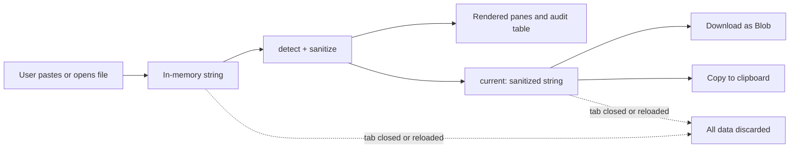

# Blackout: Data and Storage

## 1. Summary

**Blackout has no database.** This is a deliberate design decision, not a missing feature.

The challenge requires that PII is detected and redacted entirely on the client side, without sending data to any external server. A database would mean persisting sensitive text or detected values somewhere, which works against that goal. All data therefore exists only in the browser tab's memory and disappears when the tab is closed or reloaded.

If someone asks "where is the database?" in a demo, the accurate answer is: there isn't one, by design, and here is how that is enforced.

## 2. How "no storage" is enforced

| Mechanism | Status |
|---|---|
| Server or API calls | None. The Content-Security-Policy meta tag sets `connect-src 'none'`, so the browser blocks network connections from the page. |
| External resources | None. `default-src 'none'`; the page loads no external scripts, fonts, styles or images. |
| `localStorage`, `sessionStorage`, `IndexedDB`, cookies | Not used anywhere in the code. |
| Files | Read locally with the browser's File API. The sanitized result is created as an in-memory `Blob` and downloaded by the user; the app does not keep a copy. |
| Clipboard | Written only when the user presses Copy. |

How to prove it during a demo: open the browser developer tools, go to the Network tab, use the app, and show that no requests appear. In the Application tab, show that storage and cookies are empty.

## 3. In-memory data model

Everything below lives in JavaScript variables and is rebuilt on each run. None of it is persisted.

### 3.1 Input and output

| Name | Type | Description |
|---|---|---|
| `#in` textarea value | string | The raw text the user pasted or loaded |
| `current` | string | The latest sanitized text, used by Download and Copy |
| `baseName`, `ext` | string | Source file name without extension, and `.txt` or `.csv`, used to name the download |
| `mode` | `'full'` / `'partial'` / `'pseudo'` | Selected redaction mode |

### 3.2 Finding

Produced by `detect(text)`; one object per detected item.

| Field | Type | Meaning |
|---|---|---|
| `type` | `'EMAIL'`, `'CARD'`, `'AADHAAR'`, `'PAN'`, `'IP'`, `'PHONE'` | Category |
| `start`, `end` | integer | Character offsets in the original text (`end` is exclusive) |
| `value` | string | The matched original text |
| `pri` | integer | Index of the detector that matched; lower wins overlap conflicts |

Invariant: after overlap resolution, findings are sorted by `start` and no character belongs to two findings.

### 3.3 Redaction result

`sanitize(text, findings, mode)` returns `{ text, reps }`:

- `text`: the sanitized string
- `reps`: array of replacement strings, where `reps[i]` replaces `findings[i]`

### 3.4 Pseudonym mapping (pseudonymization mode only)

| Name | Type | Description |
|---|---|---|
| `map` | `Map<string, string>` | Key is `type + '|' + normalizedValue`; value is a placeholder such as `EMAIL_01` |
| `cnt` | object | Per-type counter used to number placeholders |

Both are created inside each `sanitize` call and discarded when it returns. **The mapping is never persisted.** This matters because a stored mapping from placeholders back to real values would be a re-identification table and would itself be sensitive data.

### 3.5 Temporary working structures

- `used`: a `Uint8Array` the length of the text, used during overlap resolution
- Candidate array inside `detect`
- Line-start offsets array, used to compute line numbers for the audit table

## 4. Data lifecycle



## 5. What this means for privacy

- Nothing is retained by the app after the tab closes.
- The audit table shows original values on screen, so avoid screen-sharing or screenshots with real data.
- The browser itself may keep text in its own undo history, form-restore features or extensions. The app cannot control those.
- A downloaded or copied file is outside the app's control once the user has it.
- Not verified: whether any particular browser extension on a user's machine reads page content. The no-network guarantee covers the page itself, not the user's whole browser.

## 6. Possible future storage (proposal only, not implemented)

None of the following exists in the current build. If persistence is ever added, follow these rules:

1. **Never store raw input text, detected values, or pseudonym mappings** on a server.
2. Prefer **local-only** storage in the user's browser (for example `IndexedDB`) for settings, so the "no server" promise remains true.
3. If a server database is ever introduced, it should hold only non-sensitive configuration and aggregate metadata, and the privacy claim in the product copy must be updated to match.

### 6.1 Proposed local settings (browser-side)

| Item | Example | Contains PII? |
|---|---|---|
| Preferred redaction mode | `partial` | No |
| Enabled detectors | `["EMAIL","CARD"]` | No |
| Custom rules | user-defined regex and label | Only if the user types PII into a rule; warn them |

### 6.2 Proposed server schema (only if the privacy model changes)

Metadata only. No text content, no detected values.

```sql
-- Optional: team-shared rule sets
CREATE TABLE rule_sets (
  id          UUID PRIMARY KEY,
  owner_id    UUID NOT NULL,
  name        TEXT NOT NULL,
  rules_json  JSONB NOT NULL,       -- patterns and labels only
  created_at  TIMESTAMPTZ NOT NULL DEFAULT now()
);

-- Optional: aggregate usage counts, no content
CREATE TABLE run_stats (
  id          UUID PRIMARY KEY,
  owner_id    UUID NOT NULL,
  mode        TEXT NOT NULL CHECK (mode IN ('full','partial','pseudo')),
  counts_json JSONB NOT NULL,       -- e.g. {"EMAIL":3,"CARD":1}
  created_at  TIMESTAMPTZ NOT NULL DEFAULT now()
);
```

If a database is added, also require: authentication, row-level access control, encryption in transit and at rest, and a retention limit. These are design suggestions for discussion, not tested or reviewed.

## 7. Questions to settle before adding any storage

1. Does the feature justify weakening the "nothing leaves your browser" claim?
2. Can it be done with local-only storage instead?
3. What exactly would be stored, and could any of it identify a person?
4. How long would it be kept, and who could read it?

## 8. Extension Persistence Policy (Blackout Guard)

The browser extension adheres to the identical zero-persistence model:
- **No `chrome.storage`:** Neither `chrome.storage.local`, `chrome.storage.sync`, nor `chrome.storage.session` are declared or used.
- **In-Memory Tab Scoped Undo:** The `undoSnapshot` array lives strictly in content script memory on the active tab and is destroyed immediately when navigating away or closing the tab.
- **Guard Mode Clipboard Handling:** Intercepted paste text is held only in the closure of the active modal handler during user decision and dismissed without writing to storage or disk.
