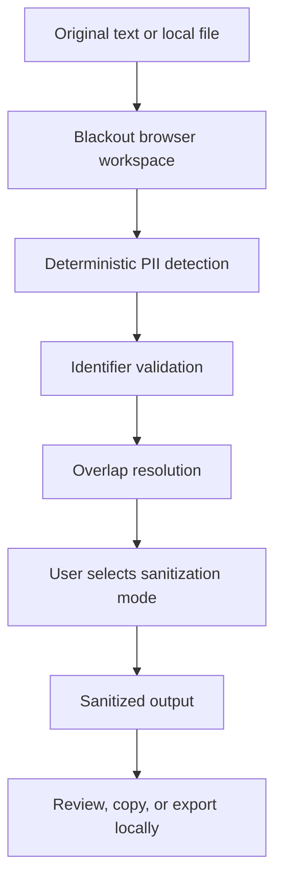
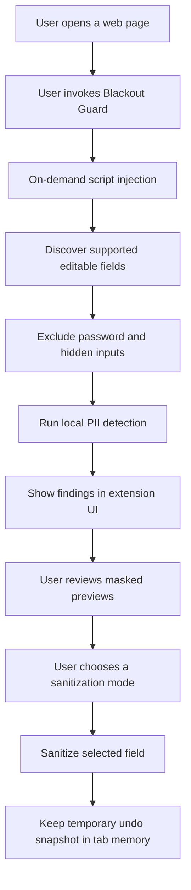
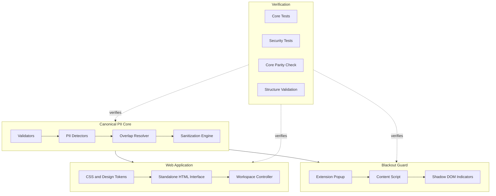
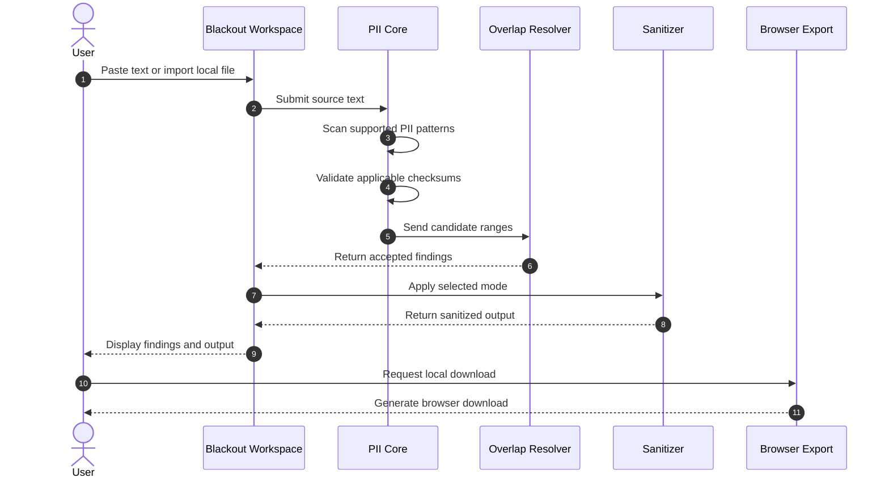

<div align="center">

# BLACKOUT

### Detect. Classify. Redact. Keep processing local.

A privacy-first, browser-based PII detection and text sanitization platform.

Blackout helps people inspect text and documents for sensitive identifiers, then redact, mask, or pseudonymize them locally in the browser — without sending the content to a processing server.

<p>
  <a href="https://github.com/shreyash-bhosale/Blackout">
    
  </a>
  <a href="docs/architecture/ARCHITECTURE.md">
    
  </a>
  <a href="docs/architecture/SECURITY_ARCHITECTURE.md">
    
  </a>
  <a href="tests/">
    
  </a>
</p>

<p>
  
  
  
  
</p>

**Your sensitive data should not need to leave your browser to become safer to share.**

[Repository](https://github.com/shreyash-bhosale/Blackout) ·
[Architecture](docs/architecture/ARCHITECTURE.md) ·
[Security Design](docs/architecture/SECURITY_ARCHITECTURE.md) ·
[Demo Guide](docs/hackathon/DEMO.md) ·
[Technical Q&A](docs/hackathon/QA.md)

</div>

---

## Table of Contents

- [Overview](#-overview)
- [The Problem](#-the-problem)
- [How Blackout Works](#-how-blackout-works)
- [Product Ecosystem](#-product-ecosystem)
- [Features](#-features)
  - [PII Detection Engine](#1-deterministic-pii-detection-engine)
  - [Sanitization Modes](#2-three-sanitization-modes)
  - [Side-by-Side Workspace](#3-side-by-side-workspace)
  - [Audit Inspector](#4-audit-inspector)
  - [Local File Processing](#5-local-file-processing)
  - [Blackout Guard Extension](#6-blackout-guard--browser-extension)
- [Architecture](#%EF%B8%8F-architecture)
- [Data Flow](#-data-flow)
- [Privacy and Security](#-privacy-and-security)
- [Threat Model and Limitations](#-threat-model-and-limitations)
- [Technology Stack](#%EF%B8%8F-technology-stack)
- [Repository Structure](#-repository-structure)
- [Getting Started](#-getting-started)
- [Browser Extension Setup](#-browser-extension-setup)
- [Testing and Verification](#-testing-and-verification)
- [Privacy Verification](#-privacy-verification)
- [Known Limitations](#%EF%B8%8F-known-limitations)
- [Roadmap](#%EF%B8%8F-roadmap)
- [Hackathon Evaluation](#-hackathon-evaluation)
- [Contributing](#-contributing)
- [License and Author](#-license-and-author)

---

## 🔍 Overview

**Blackout** is an open-source, client-side privacy tool that detects supported personally identifiable information (PII) in text and documents. Users can inspect findings and generate sanitized output before sharing content in public issue trackers, support workflows, engineering logs, datasets, or AI prompts.

Unlike a cloud redaction service, Blackout is designed to perform detection and sanitization in the browser. Its core engine uses deterministic pattern matching and identifier-specific validation algorithms. The web application and companion Chromium extension share the same detection and sanitization logic.

### At a glance

| Capability | Description |
| :--- | :--- |
| **Local processing** | Text detection and sanitization run in the browser runtime |
| **Detection** | Eight supported identifier categories |
| **Validation** | Pattern checks plus Luhn and Verhoeff checksum validation where applicable |
| **Sanitization** | Full redaction, partial masking, and consistent pseudonymization |
| **File handling** | Local TXT and CSV import/export, with a documented 5 MB input limit |
| **Browser integration** | On-demand Chromium extension for supported form fields |
| **Persistence** | No application use of `localStorage`, `sessionStorage`, `IndexedDB`, or cookies is reported by the supplied project tests |
| **Network policy** | The web application declares a restrictive Content Security Policy including `connect-src 'none'` |

> **Security scope:** Blackout is designed not to transmit the text being processed to a remote sanitization service. This is not a claim that the user's entire browser, operating system, or device is incapable of network communication. Review the security documentation and verify the deployed build before processing sensitive material.

---

## 💡 The Problem

Sensitive information can appear in ordinary day-to-day work:
- Developers paste production-like logs into public issue trackers.
- Support teams share customer tickets with external vendors.
- Analysts distribute CSV samples containing customer identifiers.
- Teams include private data in prompts sent to external AI services.
- People share screenshots or copied text without noticing embedded identifiers.

### Why cloud redaction can create another risk

A cloud-based redaction workflow may require the original document to be uploaded before it can be sanitized. That creates an additional point where sensitive content is transmitted, processed, or retained.

### Blackout takes a different approach:
**Bring the processing logic to the user's browser instead of sending the user's content to a remote processor.**

---

## 🔄 How Blackout Works



The core processing path is designed to run in the browser's memory. The application does not need a backend processing service for its described detection and sanitization workflow.

---

## 🧩 Product Ecosystem

Blackout consists of two related products powered by a shared core.

| Product | Purpose | Form factor |
| :--- | :--- | :--- |
| **Blackout Web Application** | Document inspection, side-by-side comparison, audit findings, and TXT/CSV sanitization | Standalone HTML/CSS/JavaScript application |
| **Blackout Guard** | On-demand scanning and sanitization of supported form fields on web pages | Chromium Manifest V3 extension |
| **PII Core** | Canonical detection, validation, overlap resolution, and sanitization logic | Shared JavaScript package (`packages/pii-core/`) |

The canonical engine lives in `packages/pii-core/`. The extension contains a synchronized distribution of the core, with a parity test intended to detect drift.

---

## ⚡ Features

### 1. Deterministic PII Detection Engine

Blackout combines pattern matching with validation rules to reduce obvious false positives. The supplied implementation describes eight supported categories.

| Category | Detection / validation approach | Important boundary |
| :--- | :--- | :--- |
| **Payment card numbers** | Luhn mod-10 checksum; 13–19 digits | Repeated-digit sequences are rejected; digit boundaries reduce partial matches |
| **Aadhaar numbers** | 12-digit structure and Verhoeff checksum | Leading 0 and 1 are rejected |
| **PAN identifiers** | Structural pattern plus fourth-character entity-code validation | Checks the supported entity-code set (`PCHFATBLJG`) |
| **Email addresses** | Email-oriented syntax pattern and token boundaries | Not a complete implementation of every possible email syntax |
| **IPv4 addresses** | Four-octet validation | Each octet must be in the 0–255 range |
| **IPv6 addresses** | Full eight-group hexadecimal pattern | Compressed forms are currently unsupported |
| **Indian phone numbers** | Indian mobile-oriented pattern | Supports documented +91, 0091, 0, and bare-number forms |
| **International phone numbers** | E.164-oriented pattern | Pattern-based validation; not carrier or subscriber verification |

#### Checksum validation
- **Luhn algorithm:** Used to validate candidate payment-card-like digit sequences.
- **Verhoeff algorithm:** Used for Aadhaar candidate validation. The algorithm uses permutation and multiplication tables associated with the dihedral group $D_5$.

A valid checksum does not prove that an identifier was issued, is active, or belongs to a particular person. It only validates the candidate against the implemented mathematical rule.

#### Overlap resolution
A sequence of digits can resemble more than one identifier type. Blackout resolves overlapping candidate matches using detector priority and match span.

The supplied implementation describes a `Uint8Array`-based interval collision check to keep accepted findings disjoint. This prevents multiple sanitization operations from competing for the same text range.

---

### 2. Three Sanitization Modes

Users can choose a sanitization strategy after detection.

| Mode | Behavior | Example use |
| :--- | :--- | :--- |
| **Full redaction (`full`)** | Replaces detected values with `[REDACTED]` | Public bug reports and external sharing |
| **Partial masking (`partial`)** | Preserves selected structural characters while obscuring the rest | Internal troubleshooting |
| **Pseudonymization (`pseudo`)** | Replaces normalized values with stable, category-specific aliases within a document | Dataset exploration and log correlation |

#### Examples of the documented output behavior:

| Category | Partial masking example | Pseudonym example |
| :--- | :--- | :--- |
| **Card / Aadhaar / phone** | `XXXX XXXX XXXX 1111` | `CARD_01` / category token |
| **PAN** | `XXXXXX234F` | `PAN_01` |
| **Email** | `a***@domain.com` | `EMAIL_01` |
| **IPv4** | `192.168.X.X` | `IP_01` |

> **Note:** Pseudonymization is not anonymization. Stable aliases can preserve relationships between records, and the mapping may reveal patterns. Treat pseudonymized output according to the sensitivity of the source data.

---

### 3. Side-by-Side Workspace

The web application provides a workspace for reviewing original and sanitized content:
- **Dual-pane comparison:** Original input and sanitized output appear side by side.
- **Entity highlighting:** Detected categories can be highlighted in the output view.
- **Live metrics:** Character counts, line counts, and entity totals update as the input changes.
- **Sample data:** A built-in sample is provided for demonstrating detection, including deliberate decoys.
- **Mode switching:** Change the sanitization strategy without needing to manually rewrite the source text.

---

### 4. Audit Inspector

The audit view presents detected entities in a structured table. Documented capabilities include:
- Sequential finding identifiers.
- PII category labels.
- Physical line numbers.
- Original values and sanitized replacement previews.
- Category-based filtering.
- A rendering cap of 500 rows to help keep large result tables responsive.

> **Privacy note:** The audit view can display original detected values. Review the screen before sharing a screenshot or screen recording.

---

### 5. Local File Processing

The web application supports local TXT and CSV workflows using the browser File API:
- Import `.txt` and `.csv` files.
- Documented input limit: **5 MB**.
- Process imported content in browser memory.
- Preserve CSV delimiters and column structure during string replacement, as covered by the supplied integration-test description.
- Export sanitized output using browser-generated Blob URLs.

Supported output extensions:
- `.sanitized.txt`
- `.sanitized.csv`

The file workflow is intended for local processing. Confirm the behavior of the exact build you use, especially if it has been modified or deployed with additional scripts.

---

### 6. Blackout Guard — Browser Extension

Blackout Guard brings on-demand PII scanning to supported editable fields on Chromium-based browsers, including Chrome, Edge, and Brave.



#### Extension capabilities
- **On-demand execution:** Scripts are injected when the user invokes the extension, rather than relying on a persistent background worker.
- **Sensitive-field exclusions:** Password and hidden inputs are excluded before their values are accessed, according to the supplied implementation description.
- **Shadow DOM indicators:** Isolated badges can show the number of detected findings without relying on the host page's styling.
- **Framework-aware updates:** The extension uses native input value setters and dispatches `input`/`change` events to help supported reactive frameworks recognize updates.
- **Tab-scoped undo:** An in-memory snapshot can restore a field during the active tab session.
- **Optional Guard Mode:** A paste-interception workflow can offer redact-and-paste, paste-anyway, or cancel choices when PII is detected.

The extension operates within browser and page constraints. It does not claim compatibility with every web editor or every framework implementation.

---

## 🏗️ Architecture

Blackout separates its canonical business logic from the web presentation layer, browser extension, and verification tooling.



### Architectural principles

| Principle | Implementation described by the project |
|---|---|
| **Local-first processing** | Detection and sanitization run in the browser runtime |
| **Shared business logic** | A canonical core is distributed to the web application and extension |
| **Minimal dependencies** | Core logic is written in vanilla JavaScript |
| **No application database** | The described sanitization workflow does not require a server-side database |
| **Limited persistence** | Application content is intended to remain in volatile memory |
| **Testable boundaries** | Dedicated tests cover algorithms, security properties, extension behavior, and core parity |

---

## 🔁 Data Flow



No remote processing API is required by this documented workflow.

---

## 🔒 Privacy and Security

Privacy is a core architectural requirement, not an optional feature.

### Documented controls

| Control | Project implementation |
|---|---|
| **Content Security Policy** | Web application policy includes `connect-src 'none'` |
| **Persistent browser storage** | The supplied project description reports no use of `localStorage`, `sessionStorage`, `IndexedDB`, or cookies for application data |
| **External assets** | Security tests are described as checking for external asset dependencies |
| **Input rendering** | Pasted input is escaped before being rendered into the DOM |
| **Extension permissions** | Manifest is described as using `activeTab` and `scripting`, without broad `<all_urls>` host access |
| **Password and hidden fields** | Extension excludes these input types before reading their values |
| **Extension background execution** | No persistent background worker is described |
| **Temporary undo** | Original field values are held in tab-scoped memory |

#### Content Security Policy
The supplied web application describes a policy similar to:
```html
<meta http-equiv="Content-Security-Policy" content="default-src 'none'; style-src 'unsafe-inline'; script-src 'unsafe-inline'; connect-src 'none'; img-src data:;">
```
This policy is intended to restrict resource loading and block connection-based requests initiated by the protected document. Review the actual deployed HTML and browser enforcement before relying on it as a security boundary.

#### Zero-persistence design
The application is designed to avoid writing processed content to browser persistence APIs. Data held in memory is temporary, but memory is not a secure vault: browser extensions, debugging tools, compromised processes, or other software with sufficient access may still expose it.

#### Least-privilege extension model
The extension is described as using:
```json
{
  "permissions": [
    "activeTab",
    "scripting"
  ]
}
```
The actual `manifest.json` is authoritative. Review it before installation, and do not assume that every future build retains the same permissions.

---

## 🧭 Threat Model and Limitations

### What Blackout is designed to reduce
- Accidental sharing of supported identifiers in text.
- Exposure to a third-party redaction server during the documented local processing workflow.
- Persistent application copies in common browser storage APIs.
- Unintended access to password and hidden form-field values by the extension's scanner.

### What Blackout does not protect against
- Malware, keyloggers, screen capture, or a compromised operating system.
- A compromised browser or malicious browser extension.
- Users manually copying or sharing the original unredacted content.
- Sensitive information that is not covered by the implemented detectors.
- Context-dependent information requiring semantic understanding.
- Every possible browser communication channel or behavior of unrelated browser components.
- A modified or compromised distribution of the application.

Blackout is a privacy-assistance tool. It does not replace organizational data-handling policies, legal review, or a complete data-loss-prevention system.

---

## 🛠️ Technology Stack

| Layer | Technology | Purpose |
|---|---|---|
| **Core engine** | Vanilla JavaScript (ES6+) | Detection, validation, matching, and sanitization |
| **Checksum validation** | Luhn and Verhoeff | Candidate identifier validation |
| **Web application** | HTML5, CSS3, JavaScript | Standalone browser workspace |
| **Visual background** | WebGL | Ambient mesh-drift visual effect |
| **Browser integration** | Chromium Manifest V3 | On-demand page-field scanning |
| **File processing** | HTML5 File API | Local TXT/CSV import |
| **File export** | Blob URLs | Browser-generated downloads |
| **Testing** | Node.js test runner and assertions | Automated verification |
| **Structure checks** | Custom Node.js scripts | Repository boundary and parity checks |

---

## 📁 Repository Structure

The following tree reflects the project layout supplied for this README. Confirm it against the current repository before treating it as an exhaustive file listing.

```text
Blackout/
├── README.md
├── AGENTS.md
├── .gitignore
│
├── packages/
│   └── pii-core/
│       ├── package.json
│       ├── README.md
│       └── src/
│           ├── index.js
│           ├── constants/
│           │   └── tables.js
│           ├── validators/
│           ├── detectors/
│           ├── matching/
│           ├── normalization/
│           └── sanitizers/
│
├── apps/
│   └── web/
│       ├── index.html
│       ├── README.md
│       ├── styles/
│       │   └── tokens.css
│       └── scripts/
│
├── extensions/
│   └── blackout-guard/
│       ├── manifest.json
│       ├── README.md
│       ├── popup/
│       ├── content/
│       │   └── content.js
│       ├── core/
│       │   └── pii-core.js
│       └── test/
│           └── test-page.html
│
├── tests/
│   ├── core.test.js
│   ├── hardening.test.js
│   ├── integration.test.js
│   ├── extension-core-sync.test.js
│   ├── extension-flow.test.js
│   └── extension-hardening.test.js
│
├── scripts/
│   ├── run-tests.js
│   ├── verify-core-parity.js
│   └── validate-structure.js
│
├── docs/
│   ├── README.md
│   ├── product/
│   ├── architecture/
│   │   ├── ARCHITECTURE.md
│   │   └── SECURITY_ARCHITECTURE.md
│   ├── development/
│   └── hackathon/
│       ├── DEMO.md
│       ├── QA.md
│       ├── READINESS.md
│       └── PROMPT_LOG.md
│
├── index.html
├── pii-sanitizer.html
└── blackout-guard-extension.zip
```

---

## 🚀 Getting Started

### Prerequisites
- Git
- A modern browser
- Python 3 (for the optional local static server)
- Node.js (for running the supplied test scripts)

### 1. Clone the repository
```bash
git clone https://github.com/shreyash-bhosale/Blackout.git
cd Blackout
```

### 2. Run the web application
The project provides a standalone HTML entry point. From the repository root, start a local static server:
```bash
python3 -m http.server 8080
```
Open:
[http://localhost:8080/index.html](http://localhost:8080/index.html)

You can also try opening `index.html` directly in a browser. A local server is recommended for consistent browser behavior.

### 3. Try the workflow
1. Load the built-in sample or paste text into the input pane.
2. Run the detection workflow.
3. Review detected categories and the audit table.
4. Select full redaction, partial masking, or pseudonymization.
5. Inspect the sanitized output.
6. Export the result if required.

---

## 🧩 Browser Extension Setup

Blackout Guard is intended for Chromium-based browsers:
1. Open `chrome://extensions` in Chrome, or `edge://extensions` in Edge.
2. Enable **Developer mode**.
3. Select **Load unpacked**.
4. Choose the repository's `extensions/blackout-guard/` directory (or `extension/`).
5. Pin **Blackout Guard** to the browser toolbar.
6. Open a page containing supported editable fields.
7. Invoke the extension and review the detected findings.

### Local extension test page
Start the repository's local server from the project root:
```bash
python3 -m http.server 8080
```
Then open the test page at:
[http://localhost:8080/extensions/blackout-guard/test/test-page.html](http://localhost:8080/extensions/blackout-guard/test/test-page.html)

> Only install unpacked extensions from sources you trust. Review the manifest and source code before granting browser permissions.

---

## 🧪 Testing and Verification

The project description reports six test files covering the core engine, security hardening, integration behavior, extension synchronization, extension flow, and extension hardening.

### Run the master test suite
```bash
node scripts/run-tests.js
```

### Validate repository structure
```bash
node scripts/validate-structure.js
```

### Verify core parity
```bash
node scripts/verify-core-parity.js
```

### Reported test coverage

The following results are based on the project information supplied for this README. Run the commands above against the current commit to independently confirm them.

| Test suite | Coverage | Reported tests |
| :--- | :--- | ---: |
| `tests/core.test.js` | Luhn, Verhoeff, detectors, decoys, overlap resolution, pseudonymization | 10 |
| `tests/hardening.test.js` | CSP checks, external assets, persistence checks, escaping, stress behavior | 5 |
| `tests/integration.test.js` | CSV handling, rendering, metrics, audit line numbers | 4 |
| `tests/extension-core-sync.test.js` | Web and extension core synchronization | 1 |
| `tests/extension-flow.test.js` | Field discovery, exclusions, setters, idempotency | 5 |
| `tests/extension-hardening.test.js` | Permissions, storage, network-related checks, Shadow DOM isolation | 7 |
| **Total automated tests** | **Six test files** | **32** |

The separate verification scripts also report:
- Core parity verification.
- 29 repository structure checks.

These script checks are not included in the 32-test total. A passing test suite is evidence for the cases it covers, not a proof that the application is free of all vulnerabilities.

---

## 🔬 Privacy Verification

Security claims should be independently testable. The following checks can help reviewers inspect the behavior of a local build.

### 1. Inspect network activity
1. Open the application in the browser.
2. Open Developer Tools.
3. Select the **Network** panel.
4. Enable **Preserve log**.
5. Load sample content, scan it, change sanitization modes, and export a file.
6. Inspect requests initiated by the application.

The expected result for the documented local sanitization workflow is that the application does not send the source text to a remote processing endpoint. Check the actual browser trace rather than relying only on a README claim.

### 2. Inspect browser storage
In Developer Tools, open the **Application** or **Storage** panel and inspect:
- Local Storage
- Session Storage
- IndexedDB
- Cookies

The documented design does not use these APIs to persist processed content. Verify the current build and any browser behavior independently.

### 3. Test while offline
1. Load the local application.
2. Open Developer Tools and select the **Network** panel.
3. Set network throttling to **Offline**.
4. Try the documented text detection and sanitization workflow.
5. Try local file import and export.

The standalone local workflow is designed to operate without a remote processing service. This test should be performed on the exact build being evaluated.

### 4. Inspect extension permissions
Open the extension's `manifest.json` and review its declared permissions, content scripts, host permissions, and background configuration.

---

## ⚠️ Known Limitations

Blackout intentionally documents areas where its current deterministic approach has limited coverage.

| Limitation | Current behavior |
| :--- | :--- |
| **Contextual named entities** | Person names, organizations, and context-dependent addresses are not covered by the described deterministic detector set |
| **Compressed IPv6** | Short forms such as `::1` and `fe80::1` are not currently supported |
| **Phone-number ambiguity** | Some unrelated 10-digit numeric sequences beginning with Indian mobile prefixes may be flagged |
| **Canvas-based editors** | Text rendered only to a canvas is not available through ordinary DOM field traversal |
| **Extension undo** | Temporary undo data is lost when the relevant tab is closed or navigated away from |
| **Identifier validity** | Checksum and format validation do not establish whether an identifier was issued or is currently active |
| **Detection coverage** | Unsupported formats, unusual separators, OCR text, and unrecognized identifiers may be missed |

Always review sanitized output before sharing it. Automated detection cannot guarantee that every sensitive detail has been found.

---

## 🗺️ Roadmap

Potential future improvements identified for the project:
- [ ] **Local contextual NER:** Explore a lightweight ONNX/WebAssembly model for local recognition of names and organizations.
- [ ] **Compressed IPv6 support:** Add parsing for compressed IPv6 representations.
- [ ] **Custom detection rules:** Allow users or security teams to define additional identifier patterns.
- [ ] **Document risk scoring:** Estimate document sensitivity using detected entity categories and counts.
- [ ] **Expanded extension testing:** Add automated browser journeys across a wider range of web applications.
- [ ] **Improved format coverage:** Expand tests for international identifiers, separators, and edge cases.

> Roadmap items are proposals, not claims that these capabilities are currently implemented.

---

## 🏆 Hackathon Evaluation

| Evaluation area | Blackout's approach |
| :--- | :--- |
| **Problem relevance** | Addresses accidental exposure of personal identifiers in logs, support tickets, datasets, and AI prompts |
| **Technical approach** | Combines deterministic detection, checksum validation, and overlap resolution |
| **Privacy by design** | Keeps the documented sanitization workflow in the browser rather than requiring a remote processing server |
| **Engineering structure** | Separates canonical core logic, web UI, browser extension, tests, and documentation |
| **Verification** | Includes algorithm, integration, hardening, parity, and structure checks |
| **Practical usability** | Offers three sanitization modes, local file workflows, an audit view, and browser form-field assistance |

### Suggested live demonstration
1. Show a sample document containing supported identifiers and deliberate decoys.
2. Run detection and explain why checksum validation matters.
3. Show the audit inspector and category filters.
4. Switch between full redaction, partial masking, and pseudonymization.
5. Import and export a local TXT or CSV file.
6. Demonstrate Blackout Guard on the local extension test page.
7. Use Developer Tools to inspect network activity and browser storage.

See [the hackathon demo guide](docs/hackathon/DEMO.md) and [technical judge Q&A](docs/hackathon/QA.md) for the project's supporting presentation material.

---

## 🤝 Contributing

Contributions, bug reports, and suggestions are welcome.

Before submitting a change:
1. Read the project development guidance in [`AGENTS.md`](AGENTS.md).
2. Keep the canonical detection and sanitization logic in `packages/pii-core/`.
3. If core behavior changes, update the synchronized extension distribution.
4. Add or update tests for new detection rules and edge cases.
5. Run the master test suite and structural validation.
6. Update relevant documentation.

Please avoid submitting real personal identifiers, credentials, or confidential documents in issues, pull requests, or test fixtures. Use clearly synthetic test data.

### Reporting a vulnerability
Do not publish real sensitive data or exploit details in a public issue. Use an appropriate private reporting channel if one is configured for the repository. If no private security contact is listed, contact the maintainer before disclosing sensitive details publicly.

---

## 📄 License and Author

- **Author:** **Shreyash Bhosale**
- **GitHub:** [@shreyash-bhosale](https://github.com/shreyash-bhosale)
- **Repository:** [shreyash-bhosale/Blackout](https://github.com/shreyash-bhosale/Blackout)
- **License:** Open-source under the MIT License — see [LICENSE](LICENSE).
- **Challenge:** Built for the **PromptWars × NIAT_Pune Cybersecurity & Data Privacy Hackathon Challenge**.

---

<div align="center">

### BLACKOUT

**Detect. Classify. Redact. Keep processing local.**

[GitHub Repository](https://github.com/shreyash-bhosale/Blackout) ·
[Architecture](docs/architecture/ARCHITECTURE.md) ·
[Demo Guide](docs/hackathon/DEMO.md)

Built with JavaScript and a privacy-first engineering mindset.

</div>
