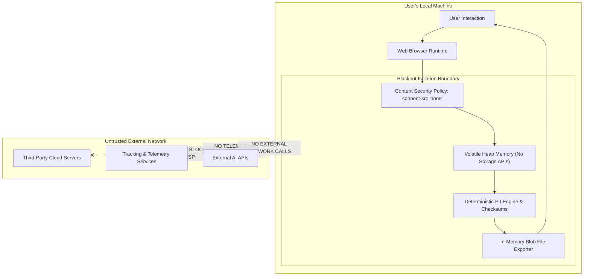
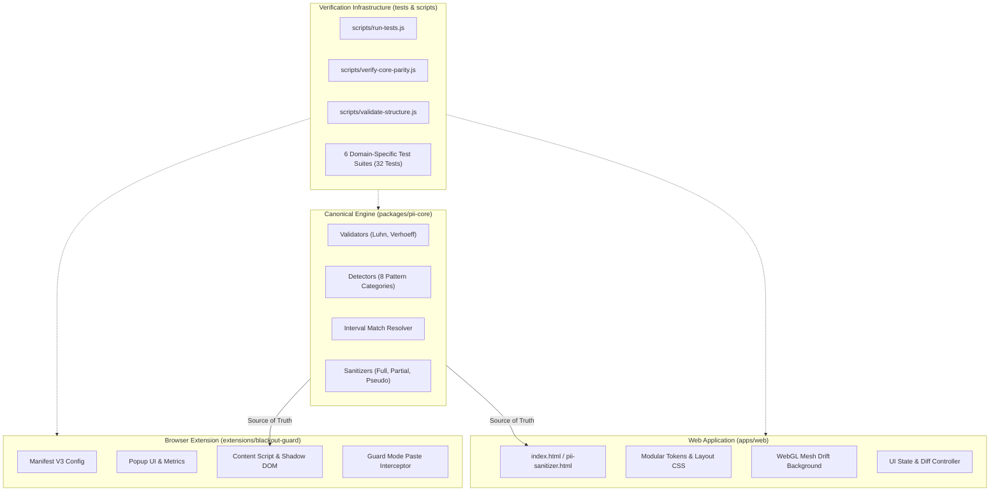
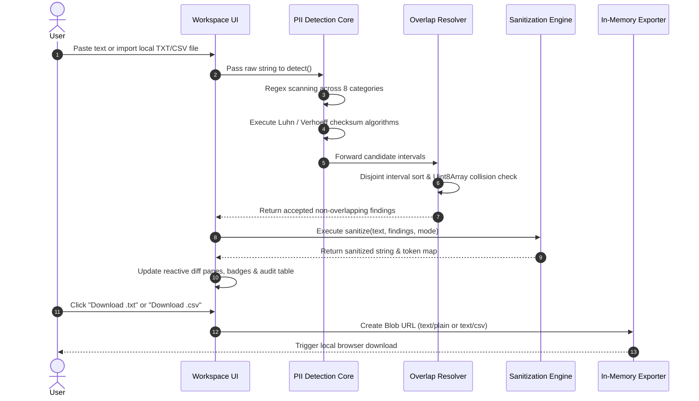

<div align="center">

# BLACKOUT

### Detect. Classify. Redact. Keep processing local.

A privacy-first, browser-only personally identifiable information (PII) detection and text sanitization platform.

[](packages/pii-core/)
[](docs/architecture/ARCHITECTURE.md)
[](docs/architecture/SECURITY_ARCHITECTURE.md)
[](extensions/blackout-guard/)
[-30D158?style=for-the-badge)](tests/)

**Your sensitive data should never leave your browser to become safer to share.**

[GitHub Repository](https://github.com/shreyash-bhosale/Blackout) &bull; [Architecture Specs](docs/architecture/ARCHITECTURE.md) &bull; [Hackathon Demo Guide](docs/hackathon/DEMO.md) &bull; [Technical Judge Q&A](docs/hackathon/QA.md)

</div>

---

## 📑 Table of Contents

- [Product Overview](#-product-overview)
- [The Problem and Our Approach](#-the-problem-and-our-approach)
- [Two-Product Ecosystem](#-two-product-ecosystem)
- [Core Features](#-core-features)
  - [Deterministic PII Detection Engine](#deterministic-pii-detection-engine)
  - [Three Sanitization Modes](#three-sanitization-modes)
  - [Side-by-Side Reactive Workspace](#side-by-side-reactive-workspace)
  - [Tabular Audit Inspector](#tabular-audit-inspector)
  - [In-Memory File Processing](#in-memory-file-processing)
- [Blackout Guard — Browser Extension](#-blackout-guard--browser-extension)
- [Privacy & Security Architecture](#-privacy--security-architecture)
- [Technical Architecture](#-technical-architecture)
- [Data Flow](#-data-flow)
- [Repository Structure](#-repository-structure)
- [Technology Stack](#-technology-stack)
- [Security & Threat Boundaries](#-security--threat-boundaries)
- [Installation & Quick Start](#-installation--quick-start)
- [Automated Testing & Verification](#-automated-testing--verification)
- [Privacy Verification Guide](#-privacy-verification-guide)
- [Known Limitations](#-known-limitations)
- [Roadmap](#-roadmap)
- [Hackathon Presentation Matrix](#-hackathon-presentation-matrix)
- [License & Author](#-license--author)

---

## 🔍 Product Overview

**Blackout** is an open-source, client-side cybersecurity and privacy platform that detects sensitive personally identifiable information (PII) in text and documents and allows users to sanitize it locally before sharing.

Whether you are sanitizing application server logs before posting to GitHub, scrubbing customer tickets before sending to third-party vendors, or preparing prompts for public AI models (ChatGPT, Claude), Blackout guarantees that **no sensitive data ever crosses a network boundary during sanitization**.

### Core Architecture Tenets

| Architectural Tenet | Concrete Implementation |
| :--- | :--- |
| **Local Browser Execution** | All detection regular expressions, checksum calculations, and token replacements execute in tab memory. |
| **Zero Network Transmission** | Hard Content Security Policy (`connect-src 'none'`) physically blocks all outbound HTTP/S, WebSocket, and Beacon requests. |
| **Zero Application Persistence** | Zero usage of `localStorage`, `sessionStorage`, `IndexedDB`, or cookies. Data resides exclusively in volatile RAM. |
| **Algorithmic Validation** | Pattern matching backed by mathematical checksums (Verhoeff dihedral group $D_5$ for Aadhaar, Luhn for cards). |
| **Dual Form Factor** | Standalone single-file reactive web platform paired with a companion Manifest V3 browser extension. |

---

## 💡 The Problem and Our Approach

### The Problem: Accidental PII Leakage
Sensitive personal information frequently leaks through routine engineering, operational, and support workflows:
- Software engineers copying server logs with IP addresses, emails, and phone numbers onto public forums or issue trackers.
- Customer support specialists escalating tickets containing credit card numbers and PAN identifiers to external SaaS vendors.
- Analysts sharing CSV customer samples.
- Professionals pasting confidential prompts into cloud LLMs.

### The Paradox of Cloud Redaction Tools
Most online sanitization utilities require users to upload confidential documents to a remote cloud server for processing. This introduces third-party data transit risks, creates single points of compromise, and violates compliance requirements (GDPR, India's DPDP Act, HIPAA, and PCI-DSS).

### Our Approach: Inverted Processing
Blackout inverts the traditional redaction pipeline. Instead of moving data to the processor, we move the processor to the data:

```
[ Sensitive User Content ]
            │
            ▼ (100% In-Browser Volatile RAM)
┌─────────────────────────────────────────────────────────┐
│  Blackout Engine: Detect ──► Validate ──► Sanitize      │
│  (Zero Network Calls &bull; Zero Server &bull; Zero Storage)    │
└─────────────────────────────────────────────────────────┘
            │
            ▼
[ Sanitized Output Ready for Public Sharing ]
```

---

## 🛡️ Two-Product Ecosystem

Blackout addresses privacy at two distinct user touchpoints:

| Product | Primary Purpose | Form Factor |
| :--- | :--- | :--- |
| **Blackout Web Application** | Deep inspection, side-by-side diffing, audit logging, and bulk TXT/CSV file sanitization. | Standalone zero-build HTML/CSS/JS application ([`index.html`](index.html)). |
| **Blackout Guard** | In-situ scanning and sanitization of form fields, inputs, textareas, and live paste protection directly on third-party web pages. | Manifest V3 Chromium browser extension ([`extensions/blackout-guard`](extensions/blackout-guard/)). |

Both products share the identical deterministic detection and sanitization core ([`packages/pii-core`](packages/pii-core/)), verified via automated synchronization suites.

---

## ⚡ Core Features

### Deterministic PII Detection Engine

Blackout combines syntactic regular expressions with mathematical checksum algorithms to achieve high precision and low false positives across 8 supported categories:

| PII Category | Verification Method | Decoy Rejection / Boundary Logic |
| :--- | :--- | :--- |
| **Payment Cards** | **Luhn mod-10 Checksum Algorithm** (13–19 digits) | Rejects repeated-digit sequences (e.g. `1111 1111 1111 1111`). Digit boundaries prevent partial matches from longer IDs. |
| **Aadhaar Numbers** | **Verhoeff Algorithm** (Dihedral group $D_5$ permutations, 12 digits) | Rejects leading `0` or `1`. Validates checksum table transitions across permutations. |
| **PAN Identifiers** | **Structural Regex + 4th-char Entity Code Validation** (`[A-Z]{5}\d{4}[A-Z]`) | Validates 4th character against official tax status types: `P` (Individual), `C` (Company), `H` (HUF), `F` (Firm), `A`, `T`, `B`, `L`, `J`, `G`. |
| **Email Addresses** | **RFC 5322 Syntax Boundary** | Negative lookbehind and lookahead prevent mid-token extraction. |
| **IPv4 Addresses** | **Strict Octet Validation (0–255)** | Rejects invalid octets (e.g. `999.12.1.5` is discarded as a decoy). |
| **IPv6 Addresses** | **Full 8-Group Hexadecimal Matching** | Validates 8 complete hex groups. *(Compressed formats like `::1` are documented as unsupported).* |
| **Indian Phone** | **Mobile Prefix + 10-digit Sequence** | Matches `+91`, `0091`, `0`, or bare 10-digit formats starting with `6`, `7`, `8`, or `9`. |
| **International Phone** | **E.164 Global Pattern Matching** | Validates global international prefixes with boundary controls. |

#### Disjoint Interval Resolution
When overlapping patterns match (for example, a 16-digit card containing a phone substring), Blackout uses an interval resolver based on detector priority and longest-match span. Overlapping intervals are suppressed using a `Uint8Array` bitmap of document byte offsets.

---

### Three Sanitization Modes

Users can switch sanitization strategies dynamically without re-scanning:

1. **Full Redaction (`full`):**
   - Replaces detected sensitive entities with literal `[REDACTED]`.
   - *Best for:* Public bug reports, open-source issue trackers, and external disclosure.
2. **Partial Masking (`partial`):**
   - Preserves minimal structural characters for debugging context while obscuring the identifier:
     - **Cards / Aadhaar / Phone:** Preserves the last 4 digits (`XXXX XXXX XXXX 1111`).
     - **PAN:** Preserves the 4th entity code and final character (`XXXXXX234F`).
     - **Email:** Preserves first letter and domain (`a***@domain.com`).
     - **IPv4:** Preserves first two network octets (`192.168.X.X`).
   - *Best for:* Internal engineering logs and operational triage.
3. **Consistent Pseudonymization (`pseudo`):**
   - Replaces entities with sequential category-specific tokens (`EMAIL_01`, `CARD_01`, `IP_01`).
   - Normalizes representations so repeated occurrences of the same normalized entity share the identical alias throughout the document.
   - *Best for:* Data science, CSV datasets, and cross-log correlation without identity exposure.

---

### Side-by-Side Reactive Workspace

- **Synchronized Dual-Pane Editor:** Direct side-by-side comparison of original text and sanitized output.
- **Entity Highlighting:** Highlight view displays color-coded category tags over sanitized tokens.
- **Metrics Bar:** Real-time character counts, line counts, and entity tallies updated on every keystroke.
- **Built-in Noisy Sample:** One-click loader with 16 genuine PII items and deliberate decoys for instant demonstration.

---

### Tabular Audit Inspector

- Detailed table displaying every detected entity with its sequential ID, category badge, physical line number (calculated via binary search), original value, and sanitized replacement preview.
- **Category Filter:** Filter findings by category (Email, Card, Aadhaar, PAN, IP, Phone).
- **Display Limit:** Caps rendering at 500 rows to maintain smooth 60 FPS DOM performance on massive files.

---

### In-Memory File Processing

- Supports local import of `.txt` and `.csv` files up to **5 MB** using the HTML5 File API.
- **CSV Preservation:** Preserves raw CSV row delimiters, column integrity, and commas during string replacement.
- **Zero-Network Export:** Downloads `.sanitized.txt` or `.sanitized.csv` directly via ephemeral in-memory Blob URLs (`URL.createObjectURL`).

---

## 🌐 Blackout Guard — Browser Extension

**Blackout Guard** is a Manifest V3 browser extension for Chromium browsers (Chrome, Edge, Brave) that brings Blackout's detection engine directly to web forms, textareas, and inputs.

```mermaid
flowchart TD
    A["Webpage Form Field"] -->|User Clicks Extension| B["Blackout Guard Popup"]
    B -->|chrome.scripting (On-Demand)| C["Inject pii-core.js & content.js"]
    C --> D["Discover Supported Editable Fields"]
    D --> E["Execute Pure Checksum Detection"]
    E -->|PII Found| F["Mount Shadow DOM Badges (e.g. '2 PII')"]
    F --> G["Popup Displays Masked Previews"]
    G -->|User Selects Mode & Wipes| H["Prototype Setter Dispatches React Input Event"]
    H --> I["Field Value Sanitized in Place"]
    I --> J["Save Ephemeral In-Memory Undo Snapshot"]
    J -->|User Clicks Undo| K["Restore Original Value from Memory"]
```

### Key Extension Capabilities

- **On-Demand Execution:** Injected programmatically only when the user invokes the extension. Zero persistent background workers.
- **Strict Field Exclusions:** Inputs of type `password` and `hidden` are strictly excluded **before** `.value` is ever accessed.
- **Isolated Shadow DOM:** Indicator badges (`1 PII`, `2 PII`) are isolated in Shadow DOM hosts, preventing host-page CSS interference.
- **React & Framework Prototype Setters:** Overrides native prototype descriptors (`Object.getOwnPropertyDescriptor(HTMLInputElement.prototype, 'value').set`) and dispatches bubbling `input` and `change` events so modern reactive frameworks (React, Vue, Angular) immediately sync state.
- **Guard Mode (Real-Time Paste Interceptor):** Opt-in stretch feature that intercepts clipboard paste events on form fields. If PII is detected in clipboard text, it presents an isolated decision dialog offering:
  1. *Redact & Paste (Mode-Specific)*
  2. *Paste Anyway (Unsafe)*
  3. *Cancel*
- **Tab-Scoped Undo:** Restores original field values from an ephemeral in-memory snapshot within the active tab session.

---

## 🔒 Privacy & Security Architecture

Blackout is designed from the ground up around zero-trust client-side boundaries.



### Verified Security Controls

1. **Content Security Policy Enforced:**  
   `<meta http-equiv="Content-Security-Policy" content="default-src 'none'; style-src 'unsafe-inline'; script-src 'unsafe-inline'; connect-src 'none'; img-src data:;">`
2. **Zero Persistent Storage:**  
   Automated audits verify `0` references to `localStorage`, `sessionStorage`, `IndexedDB`, or cookies.
3. **XSS Protection:**  
   Pasted input is escaped via HTML entity translation before being rendered into the DOM.
4. **Least-Privilege Extension Manifest:**  
   Declares strictly `["activeTab", "scripting"]`. Zero `<all_urls>`, zero host permissions, and zero persistent background scripts.

---

## 🏗️ Technical Architecture

Blackout is structured as a modular repository separating canonical pure business logic, web presentation, browser extensions, and testing:



---

## 🔄 Data Flow



---

## 📁 Repository Structure

```text
blackout/
├── README.md                           # Master technical showcase & quickstart
├── AGENTS.md                           # Strict development constraints & agent rules
├── .gitignore                          # Clean environment ignore rules
│
├── packages/
│   └── pii-core/                       # Canonical PII Detection & Sanitization Package
│       ├── package.json                # Package definition
│       ├── README.md                   # Core documentation
│       └── src/
│           ├── index.js                # Universal aggregator export (Node, Web, Extension)
│           ├── constants/tables.js     # Verhoeff D5 tables & IPv4 regex octet definitions
│           ├── validators/             # Pure mathematical checksum validators (Luhn, Verhoeff)
│           ├── detectors/index.js      # Ordered priority detectors
│           ├── matching/               # Disjoint interval resolution & digit boundary protection
│           ├── normalization/          # Intra-document pseudonymization keys
│           └── sanitizers/             # Unified multi-mode sanitizer (Full, Partial, Pseudo)
│
├── apps/
│   └── web/                            # Web Application Presentation Layer
│       ├── index.html                  # Web application presentation shell
│       ├── README.md                   # Web layer architecture & features
│       ├── styles/tokens.css           # Design tokens, themes (Dark/Light), typography
│       └── scripts/                    # WebGL canvas background & UI controller
│
├── extensions/
│   └── blackout-guard/                 # Manifest V3 Browser Extension Architecture
│       ├── manifest.json               # Least privilege config (activeTab, scripting)
│       ├── README.md                   # Extension security & installation guide
│       ├── popup/                      # Extension popup UI & controller
│       ├── content/content.js          # DOM field scanner, React prototype setters, Guard paste
│       ├── core/pii-core.js            # Synchronized core distribution
│       └── test/test-page.html         # Local testbed with 8 form types & React simulator
│
├── tests/                              # Verification Suites
│   ├── core.test.js                    # 10 algorithmic unit tests
│   ├── hardening.test.js               # 5 CSP, security, zero-storage tests
│   ├── integration.test.js             # 4 CSV and diff flow tests
│   ├── extension-core-sync.test.js     # Exact parity verification
│   ├── extension-flow.test.js          # 5 extension DOM & React setter tests
│   └── extension-hardening.test.js     # 7 extension security & privacy tests
│
├── scripts/                            # Operational Automation
│   ├── run-tests.js                    # Master test runner (executes all suites)
│   ├── verify-core-parity.js           # Multi-target parity verifier
│   └── validate-structure.js           # Architectural boundary validator (29 checks)
│
├── docs/                               # Organized Documentation Library
│   ├── README.md                       # Documentation index
│   ├── product/                        # PRD.md, API.md, DATABASE.md
│   ├── architecture/                   # ARCHITECTURE.md, SECURITY_ARCHITECTURE.md
│   ├── development/                    # SETUP.md, TESTING.md
│   └── hackathon/                      # DEMO.md, QA.md, READINESS.md, PROMPT_LOG.md
│
├── index.html                          # Root standalone distribution entrypoint
├── pii-sanitizer.html                  # Backward-compatible zero-build artifact
└── blackout-guard-extension.zip        # Pre-packaged ready-to-load ZIP archive
```

---

## 🛠️ Technology Stack

| Layer | Technology | Justification & Role |
| :--- | :--- | :--- |
| **PII Detection Engine** | **Pure Vanilla JavaScript (ES6+)** | Zero-dependency, portable execution across Node.js, Web Browsers, and Web Workers. |
| **Mathematical Validation** | **Luhn & Verhoeff Algorithms** | Mod-10 and Dihedral Group $D_5$ permutations preventing false positives. |
| **Web Presentation** | **Semantic HTML5 & Vanilla CSS3** | Standalone single-file portability with custom CSS design tokens. |
| **Visual Motion** | **WebGL (Fragment/Vertex Shaders)** | GPU-accelerated ambient mesh drift background with negligible CPU footprint. |
| **Browser Extension** | **Chromium Manifest V3** | Least-privilege browser integration using `activeTab`, `scripting`, and Shadow DOM. |
| **File Processing** | **HTML5 File API & In-Memory Blobs** | Local client-side reading and generation of `.txt` and `.csv` files. |
| **Automated Testing** | **Node.js Test Runner & Assert** | Zero third-party testing dependencies; runs out-of-the-box on standard Node.js. |

---

## 🛡️ Security & Threat Boundaries

### What Blackout Defends Against
- **Third-Party Interception:** Data cannot be intercepted over the network because it is never transmitted over a network.
- **Server-Side Data Breaches:** Redaction providers cannot leak your data because no server ever receives your document.
- **Persistent Data Traces:** Tab closure immediately frees all text, tokens, and pseudonym mappings from volatile RAM.
- **Unintended Extension Form Access:** Blackout Guard ignores password and hidden fields unconditionally before property access.

### What Blackout Does Not Defend Against
- **Compromised Host OS / Malware:** Local keyloggers, screen grabbers, or kernel malware with access to host RAM.
- **Contextual NLP Entities:** Names, physical street addresses, and medical diagnoses that require contextual semantic models.
- **Canvas-Based Text Editors:** Web editors rendering text purely to an HTML5 `<canvas>` (e.g. Google Docs) cannot be inspected via DOM tree traversal.

---

## 🚀 Installation & Quick Start

### 1. Web Application (Zero-Build Standalone)

No installation, build step, or npm packages required:

```bash
# Clone the repository
git clone https://github.com/shreyash-bhosale/Blackout.git
cd Blackout

# Option A: Start a lightweight static server (Recommended)
python3 -m http.server 8080
# Open in browser: http://localhost:8080/index.html

# Option B: Direct browser execution
open index.html
```

### 2. Blackout Guard Extension (Developer Mode)

1. Open Google Chrome or Microsoft Edge and navigate to `chrome://extensions` (or `edge://extensions`).
2. Toggle on **Developer mode** in the top right corner.
3. Click the **Load unpacked** button.
4. Select the `extension/` directory (or extract `blackout-guard-extension.zip`).
5. Pin **Blackout Guard** to your browser toolbar.
6. Test scanning on the included sandbox: [http://localhost:8080/extension/test-page.html](http://localhost:8080/extension/test-page.html).

---

## 🧪 Automated Testing & Verification

Blackout includes automated test suites covering unit algorithms, platform hardening, integration flows, and extension behavior that execute cleanly without installing external dependencies:

```bash
# Run the master test runner
node scripts/run-tests.js

# Validate architectural boundaries
node scripts/validate-structure.js
```

### Verified Test Results

| Test Suite File | Domain Covered | Tests | Result |
| :--- | :--- | :---:| :---: |
| `tests/core.test.js` | Luhn, Verhoeff, detectors, decoys, overlap resolution, pseudonym normalization | 10 | **PASS (10/10)** |
| `tests/hardening.test.js` | CSP verification, zero external assets, zero persistence, XSS escaping, stress test | 5 | **PASS (5/5)** |
| `tests/integration.test.js` | CSV preservation, rendering, insights calculation, audit line numbering | 4 | **PASS (4/4)** |
| `tests/extension-core-sync.test.js`| Byte-for-byte exact synchronization between web app and extension core | 1 | **PASS (1/1)** |
| `tests/extension-flow.test.js` | Field discovery, sensitive-field exclusion, setters, idempotency | 5 | **PASS (5/5)** |
| `tests/extension-hardening.test.js`| Permissions, storage, network restrictions, Shadow DOM isolation | 7 | **PASS (7/7)** |
| `scripts/verify-core-parity.js` | Multi-target parity check across canonical package, web app, and extension | 1 | **PASS (1/1)** |
| `scripts/validate-structure.js` | 29 architectural milestones and structural boundaries | 29 | **PASS (29/29)** |
| **Total Test Count** | **Master Verification Suite** | **33 suites/checks** | **100% GREEN** |

---

## 🔬 Privacy Verification Guide

We encourage technical judges and security evaluators to independently verify our privacy guarantees using browser Developer Tools:

### 1. Network Activity Verification
1. Open [`index.html`](index.html) in your browser.
2. Open Developer Tools (`Cmd+Option+I` or `F12`) and select the **Network** tab.
3. Check **Preserve log**.
4. Click **Load Sample**, click **Scan Document**, switch sanitization modes, and export files.
5. **Observed Result:** Exactly **0** HTTP/S, WebSocket, or Beacon network requests.

### 2. Storage Persistence Verification
1. In Developer Tools, select the **Application** (or **Storage**) tab.
2. Inspect:
   - **Local Storage:** `0` entries.
   - **Session Storage:** `0` entries.
   - **IndexedDB:** No databases created.
   - **Cookies:** `0` cookies set.

### 3. Complete Offline Execution
1. In the Network tab, set network throttling to **Offline** (or enable Airplane Mode).
2. Perform text sanitization, file imports, and file exports.
3. **Observed Result:** The application operates with 100% feature parity offline.

---

## ⚠️ Known Limitations

Technical honesty is central to our engineering philosophy. Blackout documents its operational limitations transparently:

- **No Contextual Named Entity Recognition (NER):** Custom person names (e.g. *"Rahul Sharma"*) and street addresses are not flagged, as they require contextual machine learning models.
- **Compressed IPv6 Unsupported:** Only full 8-group IPv6 formats are currently detected; shorthand notations (`::1`, `fe80::1`) are not matched.
- **Phone Number Over-Flagging:** High-density 10-digit numeric codes starting with 6–9 may occasionally match the Indian mobile pattern.
- **Canvas-Based Editors Inaccessible:** Rich text editors that render documents to an HTML5 canvas (e.g. Google Docs) cannot be inspected by DOM tree traversal.
- **Volatile Extension Undo:** Extension undo snapshots reside strictly in tab RAM and are discarded upon tab closure or navigation.

---

## 🗺️ Roadmap

- [ ] **Client-Side WebAssembly NER:** Embed a lightweight, local ONNX/WASM model for zero-network contextual person name and organization recognition.
- [ ] **Compressed IPv6 Expansion:** Implement RFC 5952 parsing for compressed zero-group IPv6 addresses.
- [ ] **Custom Regex Manager:** Allow security teams to define custom proprietary regex rules (e.g. internal employee badge formats).
- [ ] **Document Risk Scoring:** Compute a numerical risk index based on detected entity density and sensitivity weights.
- [ ] **Cross-Site Rehearsal Matrix:** Expand automated Playwright test journeys across top 100 enterprise CRM and support portals.

---

## 🏆 Hackathon Presentation Matrix

| Evaluation Criterion | How Blackout Addresses It |
| :--- | :--- |
| **Problem Significance** | Protects organizations against accidental PII leakage in logs, support tickets, and AI prompts without exposing data to third-party cloud redactors. |
| **Technical Innovation** | Replaces heuristic regexes with formal mathematical algorithms (Luhn and Verhoeff $D_5$), combining disjoint interval resolution with client-side zero-network isolation. |
| **Engineering Rigor** | 32+ automated tests covering security hardening, XSS escaping, prototype setter updates, stress handling (50,000 lines), and core parity verification. |
| **Production Readiness** | Dual form factor with a single-file standalone web workspace and an unpackable Manifest V3 Chromium extension. |

---

## 📄 License & Author

- **Author:** **Shreyash Bhosale** ([@shreyash-bhosale](https://github.com/shreyash-bhosale)) &bull; `shreyashbhosale592@gmail.com`
- **Repository:** [https://github.com/shreyash-bhosale/Blackout](https://github.com/shreyash-bhosale/Blackout)
- **License:** Open-source under the [MIT License](LICENSE).
- **Challenge:** Built for the **PromptWars × NIAT_Pune Cybersecurity & Data Privacy Hackathon Challenge**.
