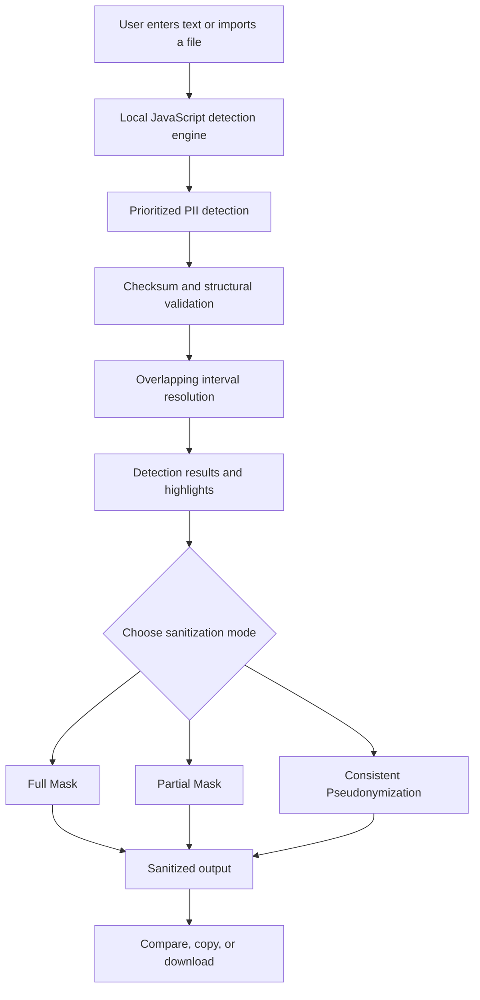
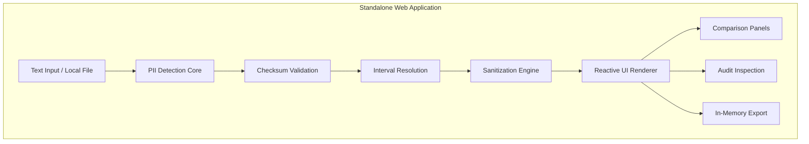
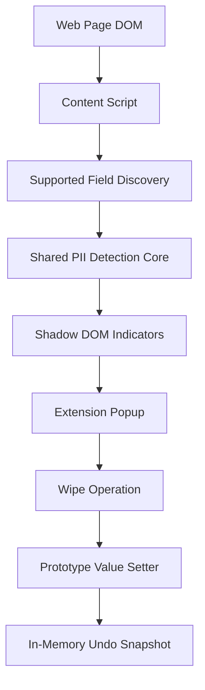

 <div align="center">

# BLACKOUT

### Detect. Classify. Redact. Keep processing local.

**A privacy-first, browser-based PII detection and sanitization platform.**

Built for the **PromptWars × NIAT_Pune Cybersecurity & Data Privacy Hackathon Challenge**


**Your sensitive data should not need to leave your browser to become safer to share.**

</div>

---

## Table of Contents

- [Overview](#-overview)
- [The Problem](#-the-problem)
- [How Blackout Works](#-how-blackout-works)
- [Features](#-features)
- [PII Detection Engine](#-pii-detection-engine)
- [Sanitization Modes](#-sanitization-modes)
- [Blackout Guard Extension](#-blackout-guard-browser-extension)
- [Technical Architecture](#-technical-architecture)
- [Privacy and Security](#-privacy-and-security)
- [Getting Started](#-getting-started)
- [Browser Extension Setup](#-browser-extension-setup)
- [Verify the Privacy Architecture](#-verify-the-privacy-architecture)
- [Automated Testing](#-automated-testing)
- [Project Structure](#-project-structure)
- [Known Limitations](#-known-limitations)
- [Roadmap](#-roadmap)
- [Responsible Use](#-responsible-use)

---

## 🔍 Overview

**Blackout** is a browser-only cybersecurity platform that detects and sanitizes personally identifiable information (PII) directly inside the user's browser.

It is designed to help developers, security researchers, administrators, and organizations identify sensitive information before sharing application logs, customer support tickets, resumes, or CSV datasets.

Unlike conventional cloud-based redaction tools, Blackout performs detection, validation, and sanitization locally using client-side JavaScript.

It also includes **Blackout Guard**, a companion Chromium browser extension that scans supported form fields and helps sanitize sensitive content directly on web pages.

### The core idea

| Principle | Implementation |
|---|---|
| Local processing | Detection and sanitization execute in the browser |
| Zero network transmission | Strict Content Security Policy and no external processing services |
| Zero persistent application storage | No application use of localStorage, sessionStorage, IndexedDB, or cookies |
| Deterministic detection | Pattern matching backed by checksum and structural validation |
| Reusable detection core | Shared pure JavaScript logic between the web app and extension |
| Dual form factor | Standalone web application and Chromium extension |

---

## 💡 The Problem

Sensitive information frequently appears in everyday development and operational workflows.

Examples include:

- Application logs containing email addresses and phone numbers.
- Customer support tickets containing financial identifiers.
- CSV exports containing personal information.
- Debugging reports containing IP addresses.
- Documents containing Aadhaar or PAN identifiers.

Traditional online sanitization tools often require users to upload confidential information to an external service before it can be redacted.

This creates another point where sensitive data may be transmitted, processed, or retained.

### Our approach

Blackout reverses the workflow.

Instead of uploading sensitive information for sanitization, users process it locally and export the sanitized result directly from their browser.

**Input → Detect → Validate → Sanitize → Export**

---

## ⚙️ How Blackout Works

<details open>
<summary><strong>Application workflow</strong></summary>



</details>

### Typical user workflow

1. Open Blackout in a browser.
2. Paste text or import a supported local file.
3. Run the PII detection engine.
4. Review the highlighted findings and category counts.
5. Choose a sanitization mode.
6. Inspect the original and sanitized versions.
7. Copy or download the sanitized output.

A built-in synthetic sample is available to demonstrate the detection engine without requiring real personal information.

---

## ✨ Features

### Implemented and reported as verified

| Feature | Description |
|---|---|
| Deterministic PII detection | Eight prioritized detector rules |
| Checksum validation | Luhn and Verhoeff algorithms |
| Strict CSP | Blocks external network connections through the configured policy |
| Full Mask | Replaces detected entities with `[REDACTED]` |
| Partial Mask | Retains selected structural information |
| Pseudonymization | Assigns consistent sequential identifiers |
| Live highlighting | Displays detected entities in the document |
| Side-by-side comparison | Displays original and sanitized content |
| Audit inspection | Finding category, document line, original value, and replacement preview |
| Local file import | TXT and CSV files up to 5 MB |
| In-memory export | Generates sanitized TXT and CSV downloads |
| Synthetic benchmark | Built-in sample containing 16 valid findings and decoys |
| Dark and light themes | Toggleable visual appearance |
| Browser extension | Companion Blackout Guard extension |

### Partially implemented

| Feature | Current status |
|---|---|
| CSV column-aware handling | Preserves CSV row structure and delimiters during text replacement; no spreadsheet-style editor |
| Guard Mode | Paste interception and decision modal implemented; manual cross-site browser rehearsal remains pending |

### Planned

- Local WebAssembly-based Named Entity Recognition.
- Custom user-defined regex patterns.
- Compressed IPv6 address parsing.
- Numerical document risk scoring.

---

## 🛡️ PII Detection Engine

Blackout uses deterministic pattern detection combined with validation rules to reduce false positives.

The detection engine includes eight prioritized detector rules.

### Supported categories

| PII Type | Detection Method | Validation |
|---|---|---|
| Email | RFC-like email pattern | Syntax and TLD length validation |
| Credit Card | 13–19 digit patterns | Luhn checksum |
| Aadhaar | 12-digit identifier | Verhoeff checksum |
| PAN | Indian tax identifier pattern | Fourth-character holder-status validation |
| IPv4 | Dotted decimal notation | Octet range validation |
| IPv6 | Full eight-group hexadecimal notation | Eight-group structure validation |
| Indian Phone | Ten-digit Indian mobile pattern | Prefix and digit-boundary validation |
| International Phone | International `+`-prefixed pattern | Country-code structure and digit-boundary validation |

### Validation details

**Credit cards — Luhn algorithm**

The detector validates candidate numbers using the Mod 10 checksum and rejects all-identical digit strings.

**Aadhaar — Verhoeff algorithm**

The detector uses Verhoeff's multiplication, permutation, and inverse tables based on the dihedral group \(D_5\).

**PAN — Tax entity validation**

The fourth character is checked against the supported holder categories:

`P, C, H, F, A, T, B, L, J, G`

**IPv4 — Numeric validation**

Each octet must satisfy:

\[
0 \leq \text{octet} \leq 255
\]

**IPv6 — Structural validation**

The current implementation supports full eight-group IPv6 addresses. Compressed forms are not currently supported.

### Detection philosophy

Blackout prioritizes deterministic validation over broad contextual guessing.

This means it intentionally does not claim to detect every type of personal information.

---

## 🔐 Sanitization Modes

Blackout offers three sanitization strategies.

### 1. Full Mask

<kbd>FULL</kbd>

Replaces every detected sensitive entity with:

```text
[REDACTED]
```

Example:

```text
Original:
Contact: user@example.com
Card: 4111 1111 1111 1111

Sanitized:
Contact: [REDACTED]
Card: [REDACTED]
```

### 2. Partial Mask

<kbd>PARTIAL</kbd>

Preserves selected structural information while obscuring sensitive characters.

| Category | Example output |
|---|---|
| Credit Card | `XXXX XXXX XXXX 1111` |
| Aadhaar | `XXXX XXXX 0124` |
| Phone | `XXXXXX4321` |
| Email | `a***@cybercorp.in` |
| IPv4 | `192.168.X.X` |
| PAN | `XXXXXX234F` |

This mode is useful when some operational context is required.

**Important:** Partial masking does not necessarily make information anonymous.

### 3. Consistent Pseudonymization

<kbd>PSEUDO</kbd>

Replaces detected identifiers with sequential aliases.

Examples:

```text
EMAIL_01
CARD_01
PHONE_01
IP_01
```

Normalization ensures equivalent representations can map to the same alias within a document.

For example:

```text
Alice@corp.com
alice@CORP.COM
```

Both can map to the same pseudonym.

Similarly, supported formatting variations of phone numbers can map to one consistent alias.

This helps preserve relationships between repeated entities without retaining their original representation in the sanitized output.

---

## 🌐 Blackout Guard — Browser Extension

**Blackout Guard** extends the local sanitization experience to supported editable fields on web pages.

It uses Chrome's Manifest V3 extension architecture.

### Core capabilities

- On-demand scanning of supported form fields.
- Detection using the shared PII engine.
- Isolated Shadow DOM indicators and badges.
- In-place field sanitization.
- React-compatible prototype setters for supported input elements.
- Tab-scoped, in-memory undo.
- Password and hidden input exclusion.
- Guard Mode paste interception with a decision interface.

### Supported field categories

- Text inputs.
- Email inputs.
- Telephone inputs.
- Search inputs.
- URL inputs.
- Textareas.
- Supported contenteditable elements.
- Same-origin frames where supported by the implementation.

Password and hidden inputs are excluded.

### Guard Mode

Guard Mode is a stretch feature for paste protection.

Its implemented decision interface provides:

| Action | Intended behavior |
|---|---|
| Redact & Paste | Paste sanitized content |
| Paste Anyway | Continue with the original paste |
| Cancel | Cancel the paste operation |

Automated DOM flow tests cover the implemented flow. Manual cross-site browser compatibility remains to be verified.

### Extension privacy design

- No remote processing.
- No persistent storage.
- No account or synchronization system.
- In-memory undo snapshots.
- Limited extension permissions.

The extension uses `activeTab` and `scripting` as its declared permissions.

### Extension setup

See [Browser Extension Setup](#-browser-extension-setup).

---

## 🏗️ Technical Architecture

Blackout separates its pure detection and sanitization functions from interface rendering and browser DOM manipulation.

### Web application architecture



### Browser extension architecture



### Shared detection core

The core detection functions are enclosed between:

```javascript
// CORE START
// ...
// CORE END
```

in `pii-sanitizer.html`.

The functions are designed to be independent of DOM and browser window references.

The extension uses a corresponding copy:

```text
extension/pii-core.js
```

A synchronization test checks byte-for-byte parity between the web application core and extension core:

```text
tests/extension-core-sync.test.js
```

This reduces the risk of inconsistent detection behavior between the two form factors.

---

## 🔒 Privacy and Security

Privacy is a foundational architectural requirement, not an optional setting.

### Zero-network architecture

The application uses a restrictive Content Security Policy.

The configured policy includes:

```text
default-src 'none'
connect-src 'none'
```

This is intended to prevent external network connections from the application.

### Zero persistent application storage

Blackout does not use the following browser persistence mechanisms for application data:

- `localStorage`
- `sessionStorage`
- `IndexedDB`
- Cookies

Document processing occurs in volatile browser memory.

### In-memory file handling

Supported files are read through the HTML5 File API.

Sanitized exports are generated using in-memory Blob URLs.

The current file size limit is **5 MB**.

### Secure rendering principles

The application uses safe text rendering and includes hardening tests for XSS escaping.

The extension uses Shadow DOM to isolate its indicators and decision interface from host-page CSS.

### What the architecture does not guarantee

Blackout does not guarantee protection against:

- Host operating system malware.
- Keyloggers.
- Screen recording.
- Malicious browser extensions.
- Every possible form of PII exposure.
- Every possible browser or website compatibility issue.

A local-first architecture reduces unnecessary data transmission; it does not make the user's device invulnerable.

---

## 🚀 Getting Started

Blackout is designed as a standalone HTML application.

It requires:

- A modern browser.
- JavaScript enabled.
- Support for the regex features used by the implementation, including lookbehind.
- No package installation.
- No application server requirement for the standalone HTML workflow.

### 1. Clone the repository

```bash
git clone <YOUR_GITHUB_REPOSITORY_URL>
```

### 2. Enter the project directory

```bash
cd PromptWars_Hackthon
```

### 3. Open the application

Open:

```text
pii-sanitizer.html
```

Alternatively, open the file directly in your browser:

```text
file:///path/to/PromptWars_Hackthon/pii-sanitizer.html
```

The project also identifies `index.html` as an alternative entry point.

### 4. Start using Blackout

1. Paste text or import a local file.
2. Load the built-in noisy sample if desired.
3. Scan the content.
4. Review the detection results.
5. Select a sanitization mode.
6. Inspect the sanitized output.
7. Copy or download the result.

No package installation or build process is required for the standalone workflow.

---

## 🧩 Browser Extension Setup

Blackout Guard supports Google Chrome, Microsoft Edge, and compatible Chromium-based browsers.

Verify the current browser extension instructions against the relevant Chrome or Edge documentation.

### 1. Open the extensions page

For Chrome:

```text
chrome://extensions
```

For Microsoft Edge:

```text
edge://extensions
```

### 2. Enable Developer Mode

Enable the Developer Mode toggle.

### 3. Load the extension

Select:

```text
Load unpacked
```

Choose the project's:

```text
extension/
```

directory.

### 4. Pin Blackout Guard

Open the browser extensions menu and pin Blackout Guard to the toolbar.

### 5. Open the test page

Navigate to:

```text
extension/test-page.html
```

Use the synthetic test page to examine supported scanning, indicators, wiping, and undo behavior.

---

## 🔬 Verify the Privacy Architecture

Blackout encourages independent technical verification.

You can inspect its network and browser storage behavior using browser developer tools.

### Network verification

1. Open `pii-sanitizer.html`.
2. Open Developer Tools.
3. Select the Network tab.
4. Enable Preserve log.
5. Clear the existing network log.
6. Load the synthetic sample.
7. Scan the text.
8. Switch sanitization modes.
9. Copy and download sanitized output.
10. Inspect the Network panel.

The expected result under the documented application workflow is zero HTTP/HTTPS, WebSocket, or Beacon requests.

### Browser storage verification

Open the Application tab in Developer Tools.

Inspect:

| Browser storage | Expected application entries |
|---|---|
| Local Storage | 0 |
| Session Storage | 0 |
| IndexedDB | No application databases |
| Cookies | 0 application cookies |

### Offline verification

1. Open the Network tab.
2. Enable Offline network throttling.
3. Repeat the application workflow.
4. Check that text entry, detection, sanitization, and in-memory export continue to function.

**Verification note:** These are reproducible verification procedures and expected results, not a substitute for independently testing the exact build being evaluated.

---

## 🧪 Automated Testing

Blackout includes six Node.js test suites that can run without installing additional packages.

### Run all test suites

```bash
node tests/core.test.js &&
node tests/hardening.test.js &&
node tests/integration.test.js &&
node tests/extension-core-sync.test.js &&
node tests/extension-flow.test.js &&
node tests/extension-hardening.test.js
```

### Test coverage

| Test Suite | Coverage | Tests |
|---|---|---:|
| `core.test.js` | Luhn, Verhoeff, detector behavior, decoys, overlap resolution, pseudonym normalization | 10 |
| `hardening.test.js` | CSP, network restrictions, storage, XSS escaping, stress testing | 5 |
| `integration.test.js` | CSV preservation, rendering, metrics, audit line numbering | 4 |
| `extension-core-sync.test.js` | Web and extension detection-core parity | 1 |
| `extension-flow.test.js` | Field discovery, sensitive-field exclusion, setters, idempotency | 5 |
| `extension-hardening.test.js` | Permissions, storage, network restrictions, Shadow DOM isolation | 7 |
| **Total** | **Six test suites** | **32** |

### Reported test status

The supplied project status reports:

<kbd>32 PASSED</kbd> <kbd>0 FAILURES</kbd>

Run the commands above against the current checkout to independently confirm this result.

Automated DOM simulations do not replace manual testing in real browsers and across different websites.

---

## 📁 Project Structure

The following is a logical overview of the files referenced by the project documentation.

```text
PromptWars_Hackthon/
│
├── pii-sanitizer.html
├── index.html
│
├── extension/
│   ├── manifest.json
│   ├── popup.html
│   ├── popup.js
│   ├── popup.css
│   ├── content.js
│   ├── pii-core.js
│   ├── test-page.html
│   └── README.md
│
├── tests/
│   ├── core.test.js
│   ├── hardening.test.js
│   ├── integration.test.js
│   ├── extension-core-sync.test.js
│   ├── extension-flow.test.js
│   └── extension-hardening.test.js
│
└── Prompt/
    ├── AGENTS.md
    ├── Blackout_PRD.md
    ├── ARCHITECTURE.md
    ├── DATABASE.md
    └── API.md
```

This tree highlights the documented project structure; check the repository for the complete current file list.

---

## ⚠️ Known Limitations

Blackout is a pattern-based sanitization tool. Its limitations are important to understand.

| Limitation | Explanation |
|---|---|
| No Named Entity Recognition | Person names and contextual personal information are not detected |
| No street address detection | Address recognition requires contextual NLP |
| Compressed IPv6 unsupported | Formats such as `::1` and `fe80::1` are not currently matched |
| Phone-number false positives | Some 10-digit account or transaction numbers may resemble Indian phone numbers |
| No spreadsheet-style CSV editor | CSV structure is preserved during replacement, but no spreadsheet grid is provided |
| Canvas-based editors unsupported | The extension cannot inspect text rendered inside canvas-based editors |
| Extension undo is temporary | In-memory undo snapshots are lost when a tab is navigated or reloaded |
| Cross-site compatibility | Website-specific DOM behavior requires additional manual verification |

### Important distinction

A detector can identify supported syntactic patterns, but it cannot guarantee that every sensitive entity in a document has been found.

Always review sanitized documents before sharing them.

---

## 🗺️ Roadmap

The following capabilities are planned and are not part of the currently documented release.

- [ ] Local WebAssembly Named Entity Recognition using an ONNX/WASM model.
- [ ] Contextual person-name detection.
- [ ] Street-address detection.
- [ ] Custom user-defined regex patterns.
- [ ] Compressed IPv6 parsing.
- [ ] Numerical document risk-scoring heuristic.
- [ ] Expanded browser compatibility testing for Guard Mode.
- [ ] Additional CSV inspection and editing capabilities.

---

## ⚖️ Responsible Use

Blackout is an open-source technical prototype developed for the **PromptWars × NIAT_Pune Cybersecurity & Data Privacy Hackathon Challenge**.

It is designed to assist engineers, researchers, and administrators in reducing sensitive data exposure by identifying and redacting supported syntactic PII patterns locally.

Blackout does not guarantee complete anonymization.

Using Blackout does not certify compliance with:

- GDPR
- HIPAA
- India's Digital Personal Data Protection Act (DPDP Act)

Formal regulatory compliance requires broader organizational, legal, technical, physical, and operational safeguards.

### Use Blackout as an additional privacy layer — not as a replacement for responsible data handling.

---

<div align="center">

## BLACKOUT

**Detect. Classify. Redact. Keep processing local.**

Built for the PromptWars × NIAT_Pune Cybersecurity & Data Privacy Hackathon Challenge.

</div>
